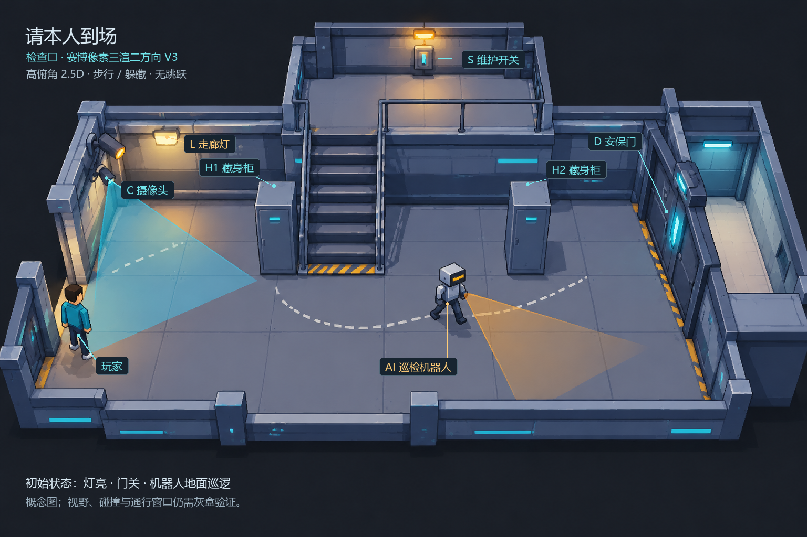

# 潜入改线：检查口关卡候选

> **2026-11-14 状态更新：本稿为历史候选。**当前改为[侦测定位机制](../../侦测定位_机制草案.md)：装置返回有人／无人／无法确定，机器人按系统命令范围巡逻，系统提交坐标范围命中才判负。本文下方追逐、自动检修、摄像头接门与维修开门流程均不再是现行承诺；V3图继续作空间和美术参考。

> 日期：2026-11-13。状态：纸面讨论稿，未实现、未试玩。用户已同意继续研究“玩家潜入、自己的 Agent 改线”；本稿的布局、守卫规则与 RESET 细则均为待验证提案。
> 当前目标：先让同一次潜入中的观察、规划、改线与执行形成因果链。原“档案—申诉—见证台—代理结局”不属于本关。
> 视觉更新：依用户要求改为固定等距俯视的2.5D关卡，取消跳跃；本文件旧横版示意已由下方空间关系替换。正式绘制约束见[2.5D绘制说明](../../output/archive/visuals/legacy_请本人到场/请本人到场_检查口_2.5D绘制说明_v1.md)。



上图于2026-11-14按用户意见，由 V2 布局编辑为赛博设施、简化人物与 AI 双足巡检机器人；采用低多边形、像素边缘和色阶阴影的三渲二视觉提案。通过已授权的供应商图像API生成，短标签为本地后加。保留高位俯视、两个柜子、一段楼梯和关闭的出口门。场景布局为概念表达，视野、碰撞与行动窗口仍需灰盒验证。[无标注原图](../../output/archive/visuals/legacy_请本人到场/请本人到场_检查口_赛博像素三渲二_v3_raw.png)。

**敌人身份更新**：本文后续“守卫”统一指 AI 巡检机体，不再是人类 NPC。它是世界 Agent 的现场执行端；世界 Agent 管理重建，机器人按既定流程巡逻与检修，个人 Agent 帮玩家理解线路并改接设备。沿用双足机体是为了正常步行上楼、操作实体开关，不使用会绕过地形的悬浮无人机。世界 AI 的系统身份与机器人的行为实现分开，不能把“机器人是 AI”当成已证明生成式 AI 玩法价值。

## 1. 一句话与胜负

玩家观察摄像头、照明和守卫的现场状态，与能读取线路并改接设备的个人 Agent 合作，打开门并亲自穿过检查口；被安防系统抓获后，世界 Agent 重建房间，并从有限模板中修补一个已暴露的线路漏洞。

- 胜利：玩家角色越过右侧的区域边界。门开了但玩家还没过去，不算通关。
- 失败：摄像头触发仍连接着的警报，或守卫确认发现/近身抓到玩家。
- 成功越界即可结束本关；不强制第一次通关后拉回重走。
- 世界 Agent 只在本区域发生明确抓获事件后拥有重建权限，不能在玩家成功越界后追溯取消通关。
- 本关不安排代办身份、见证台或求助次数结算。“过度依赖 Agent”的额外代价仍待设计，不能冒充已经解决。

## 2. 房间全貌

固定等距俯视的2.5D单屏关卡。玩家沿地面自由前后左右移动，不跳跃。前侧是带两个藏身柜的检查通道，后侧是高于地面一层的值班台；值班台通过一段普通楼梯与地面相通，不通向出口。这里的“前／后”指地面深度，“上层”指实际高差，二者不能混淆。

```text
后侧：[封闭维护墙] [上层值班台 S] [出口隔墙]
                         │楼梯        │
前侧：[入口]—C—H1—[地面巡逻通道]—H2—D—[出口]
                     [走廊灯 L 照亮地面]
```

- H1 在摄像头检测区之后、守卫常规巡逻区之前。玩家可以在此安全观察地面和楼梯。
- H2 在巡逻区内，用于让守卫经过后再向右移动。两个柜子靠墙放置，不阻挡巡逻路线。
- D 位于封闭出口隔墙的唯一缺口，封住整个可通行宽度；不能从通道前后侧或值班台绕过。画面剖开墙体只为看清室内，不代表那里没有碰撞边界。
- 守卫正常只在地面巡逻。灯突然熄灭时，会走楼梯上值班台按 S，尝试恢复照明。
- 值班台位于通道后侧，不悬在主要行动区正上方；固定相机能看清楼梯上下口、两个柜子及门。栏杆与高差阻止上下层直接平移或跳落，只能经楼梯通行。守卫的上下层视野按遮挡处理；玩家能看到守卫是否上楼，Agent 的线路接口不提供守卫即时位置。
- 玩家也可以走楼梯接近 S；不人为设置“只有守卫能按”的权限。若玩家自己潜入上层触发改接后的 S，同样是合法解。

## 3. 玩家操作与规划暂停

| 输入 | 动作 |
| --- | --- |
| W / A / S / D | 沿地面前后左右移动；走向楼梯即可沿楼梯上下层 |
| E | 进入/离开藏身柜，或按身边开关 |
| Tab | 打开个人 Agent 对话，进入规划暂停 |
| 继续 | 关闭对话，恢复现场运行 |

取消跳跃操作。无跳台、跨坑、攀爬、翻越和自由跳落；所有必要位置通过连续地面或普通楼梯可达。2.5D确定画面和空间关系，Godot使用2D投影还是3D场景仍待实现阶段选择。

规划暂停冻结玩家、守卫和传感器；Agent 此时可读取线路、提交经玩家批准的改线。外部 Agent 接入也使用同一暂停状态。网络等待不会让玩家被抓，但 Agent 不能在暂停中凭空触发摄像头、开关或角色动作。

## 4. 四个设备的初始规则

| 设备 | 初始状态 | 触发/响应 |
| --- | --- | --- |
| 摄像头 C | 接警报 | 未授权玩家首次进入视野时发出一个脉冲；持续处于视野不会每帧重复发信号 |
| 照明开关 S | 接灯 L | 玩家或守卫按下时发出一个脉冲 |
| 走廊灯 L | 亮 | 收到脉冲后切换亮/灭 |
| 安保门 D | 关 | 收到开门脉冲后保持开启，直到本轮 RESET |

基础模板允许把 C 接到警报、L 或 D，把 S 接到 L 或 D。每个信号源同时只接一个目标。替换接线后不再触发原目标；没有改线次数扣分，也没有隐藏的求助计数。

- 摄像头有独立夜视，熄灯不等于自动关闭摄像头；改变其输出才能消除报警。
- 守卫有合法身份，经过摄像头不会触发未授权检测。
- 灯灭后，守卫视野缩短但近身接触仍会抓获玩家；黑暗不等于无敌。
- 接线不等于触发。把 C 接 D 后，必须有人进入 C 的检测区，D 才会开。
- 禁止 Agent 直接调用“开门”“传送玩家”“控制守卫”绕过上述因果链。

## 5. 守卫的行为

守卫是一台 AI 巡检机器人。巡逻、视野检测、抓获和检修先由确定性状态机控制，不需要每帧请求模型或生成式对话。世界 Agent 在 RESET 时选择受限配置；两者在世界观中属于同一套安防系统。玩家利用机器人已知的维护流程创造通行窗口，个人 Agent 不直接遥控机器人。

1. 平时在地面两端之间巡逻，视野方向在画面显示。
2. 发生一次“灯亮→灯灭”时，前往楼梯，上值班台按 S。
3. 如果灯恢复，返回巡逻。
4. 如果灯没有恢复，显示“开关失灵？”反馈，短暂检查上层灯控，再返回巡逻。
5. 灯持续熄灭不反复触发无限维修。再次亮起后又熄灭，才产生下一次照明事件。

上楼、按开关和检查的总时长应给玩家从 H1 到 D 留出宽裕窗口。实际窗口必须由灰盒移动距离测量后确定，不能先锁死秒数再把房间凑上去。

## 6. 玩家与 Agent 各掌握什么

玩家看到：设备在空间里的位置、守卫正在朝哪边走、楼梯与藏身柜是否可达、自己何时能行动。

Agent 读到：设备标识、当前接线、允许目标、灯和门的设备状态、维护规则“熄灯后巡检机器人会按 S 复位”、历史抓获与重建记录。接口不提供当前守卫坐标、朝向、角色视角图像或可直接调用的移动动作。

这是一种候选的信息分配，不声称对 Agent 而言游戏画面在技术上不可读取。是否为后续版本增加视觉输入，需重新评估合作机制。

关键对话应围绕可执行条件：“S 在哪里？”“守卫去按 S 会不会离开你要经过的通道？”“你能否先到 H1？”“门开后从这里到出口来得及吗？”Agent 对不知道的现场信息应明确提问，而非假装已经观察到。

## 7. 解法一：直接开门，玩家躲巡逻

这是较直观的通法，用于教学或作为 RESET 后的退路。

1. 玩家在入口观察 C、H1、地面巡逻和 D，并向 Agent 说明现场。
2. Agent 读取线路，提出 C→D；玩家批准。
3. 玩家恢复游戏，进入摄像头视野。C 不再报警，D 打开。
4. 玩家进入 H1，观察守卫。
5. 守卫向右走时，玩家从后方跟进，到 H2 藏好；不能追上并碰到守卫。
6. 守卫从右端折返、向左经过 H2 后，玩家离柜向右，穿门越界。

这一路灯仍亮，玩家需要分两段移动并利用藏身柜。门常开，不需在模型延迟和关门倒计时之间抢跑。

## 8. 解法二：让守卫替玩家开门

这一方案用两次改线，把灯光、守卫行为和门连成一条过程。

### 规划

玩家：“门前有守卫，开门后我也不敢直接过去。”

Agent：“照明故障时，值班员会按 S。S 在哪里？他去那里，会离开门前吗？”

玩家：“S 在上层值班台。他得走楼梯上去，地面就空了。摄像头后面有柜子，我可以先躲进去。”

Agent 提案：把 C 从警报接到 L，把 S 从 L 接到 D。玩家确认两条接线后恢复现场。

### 执行

1. 玩家走入 C 的视野。
2. C 的脉冲使 L 由亮变灭，没有触发警报。
3. 玩家进入 H1。守卫看到熄灯，离开地面巡逻区，走楼梯上值班台。
4. 守卫按 S，准备开灯。
5. 因为 S 已接到 D，门打开；灯没有恢复。
6. 守卫留在上层检查灯控。玩家离开 H1，从空出的地面走廊穿过 D、越过边界。

反馈必须让因果可见：摄像头扫描→灯灭；守卫产生维修意图并上楼；按 S 时线路亮起→门开；玩家亲自穿过地面。

这条链利用守卫既有的维修行为。Agent 没有获得控制 NPC 的额外能力。

若玩家想到自己先上楼按已改接的 S，也应允许；不要用任意限制强迫照抄示范解。

## 9. 一次合理失败与 RESET

假设玩家批准了第二种方案，却在触发熄灯后立刻冲向 D。守卫还在地面前往楼梯，双方相遇，玩家被抓。

这是未确认行动窗口的失败，不是游戏按“用了两次 Agent”判负。正常助手也应提醒“等守卫上楼、门打开再行动”，不能故意给坏建议制造代价。

RESET 流程：

1. 画面先展示抓获原因，例如“守卫尚未离开地面，你在楼梯口与其相遇”。
2. 世界 Agent 读取本轮公开安防事件，从合法房间配置中选一个修补项，并给出简短通知。
3. 位置、灯、门、巡逻和原始接线恢复；玩家与个人 Agent 保留证据来源清晰的上一轮日志和计划记录。
4. 本例修补 C→L：摄像头不能再接照明，但仍可接门。S 仍可改接 D。
5. Agent 必须读取新版本，说明熄灯计划已失效，改用直接开门、H1/H2 躲巡逻的方案，或让玩家实地潜入上层按改接后的 S。

世界 Agent 的另一个合法配置可以修补 C→D，但仍保留 C→L 与 S→D，让第二种方案成立。修补不永久叠加；每次重建选择一份完整合法配置，不能逐次把所有通路封死。

| 配置 | C→D | C→L | S→D | 已知通法 |
| --- | --- | --- | --- | --- |
| 基础 | 可用 | 可用 | 可用 | 直接开门，或熄灯引守卫开门 |
| 修补照明改接 | 可用 | 禁止 | 可用 | 直接开门，利用 H1/H2 躲巡逻 |
| 修补摄像头开门 | 禁止 | 可用 | 可用 | 熄灯后守卫按 S 开门 |

世界的修补依据是实际设备信号和抓获事件，与私人对话或求助次数无关。表中只检查了逻辑通路，尚未验证走位窗口。

手动重试按钮只回到本轮配置，不额外生成世界修补；避免玩家为比较方案而每次都被强制换题。抓获后的世界重建是本关主要 RESET 事件。

## 10. Agent 接口与失败边界

概念接口先保持很小：读取线路与版本、读取维护文档与重建记录、提交接线提案、在玩家批准后应用接线。

- 两条接线提案可以成批提交；任何一条非法，整份提案不生效，避免半改线状态。
- RESET 增加房间版本。上一轮版本的操作被拒绝，不得静默套用。
- 未批准的提案不改变现场。修改成功必须用图示显示旧目标与新目标。
- 外部 skill 描述同一组受控接口；它不授予任意文件删除、读全盘或绕过游戏规则的能力。
- 超时保留规划暂停与现有状态，允许重试或切到同权限的内置助手；不得在失败时偷偷打开门。
- 规划暂停期间，世界 Agent 不改房间；守卫不会在对话中继续移动。

## 11. 这版能够与不能够支持的结论

能够支持的纸面主张：玩家提供空间与时机信息；个人 Agent 提供电路关系和受限改线；两者围绕同一次通行形成计划；世界重建使其中一种计划失效，并保留其他通法。

未解决：

- 两种接线方案仍可能被静态提示或菜单替代。多步计划本身不能证明生成式 AI 必要，必须观察自由提问、补充现场信息和修订方案的实际价值。
- 盲目冲出掩体会失败，但这只是观察与执行的要求。不能据此声称“过度依赖自己的 Agent”已有独特、完整的代价机制。
- 本关使用三份合法配置，世界 Agent 的自由编辑度有限，不宣称它可以自主生成任意关卡。
- 新手是否能看懂“熄灯→上楼→按开关→开门”，以及等待是否有趣，尚未验证。
- 本关并非每局都强制 RESET。熟练玩家第一次即通关是允许的；预赛演示可以展示一次真实失败及其变更，不制造必败开场。

## 12. 72 小时范围与首个验证

原型边界：一屏、一个上层值班台、一段固定楼梯、两个藏身柜、C/S/L/D 四种设备、一名固定状态机守卫、个人 Agent 对话与受控接口、世界 Agent 三份合法配置、胜负与重启。无战斗、装备树、自由 NPC 社交、档案申诉或见证结局系统。

首玩目标可按 8–10 分钟规划，含学习、讨论与可能的重试；熟练通关可以更短。当前没有试玩计时，不能把时长当作已验证结果，也不能靠延迟或强制失败凑时长。

首个灰盒只检验：玩家是否能和助手共同理解并执行“利用守卫的维修行为开路”。接线、触发、灯光、守卫、躲藏和到达出口必须真实运行；可先由开发者扮演助手，再接入模型。这样能区分基础谜题问题与模型接口问题。

通过条件包括：新玩家能解释门为什么被守卫打开；至少能提供一条现场信息影响助手建议；两种通法都能实际完成；RESET 后能识别旧计划为何失效。未达到时先修布局或反馈，不增加更多 NPC 和机关。

## 13. 基础玩法来源

这是借鉴成熟机制的候选，不把改接线路本身作为原创点。

- [Tom Francis：Gunpoint Trailer: Gadgets And Steam（2013-04-22）](https://www.pentadact.com/2013-04-22-gunpoint-gadget-trailer/)：开发者说明灯、开关、摄像头和门可交叉接线，并明确举例把摄像头从警报改接到门，再由玩家进入视野触发开门。

具体的 C→L、S→D、上层维修台、玩家侧 Agent 分工及 RESET 修补，是本稿自己的待验证组合，不声称为原作的逐项规则。
