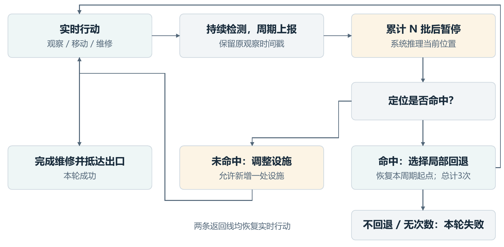
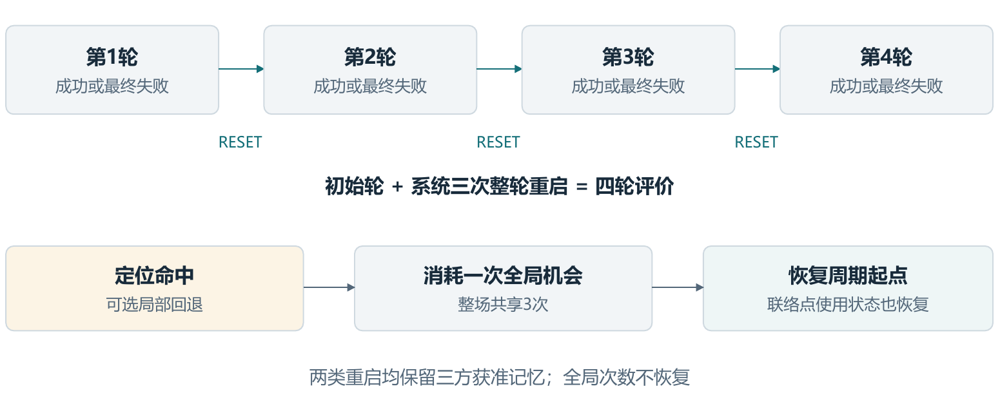
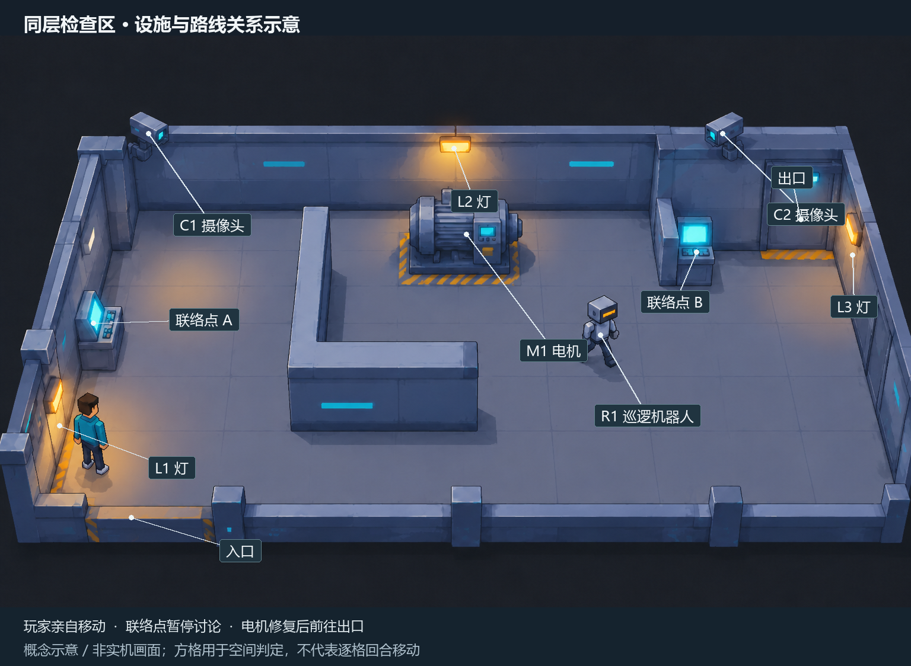

# 《请本人到场》预赛玩法框架 v0.2

这份文件是预赛方案的快速阅读版。完整文案见 [AI_PLAY_72H_预赛方案_v0.2.md](../submissions/AI_PLAY_72H_预赛方案_v0.2.md)，提交版 PDF 见 [AI_PLAY_72H_预赛方案_v0.2.pdf](../submissions/AI_PLAY_72H_预赛方案_v0.2.pdf)。

## 一句话玩法

玩家在一张同层方格检查区里实时移动，修复电机并到达出口；玩家自己观察安防设施，在联络点把现场描述给没有地图的个人助手，由助手提交少量灯光或摄像头改动。城市系统按带时间戳的设备报告周期性猜测玩家位置。猜错会增加监控，猜中则玩家可以局部回退。整轮 RESET 会重置现场，但保留三方记忆。

## 三个必须讲清的动作

1. **玩家手操**：走位、观察路线、躲开固定视野、维修电机、选择何时撤离。
2. **个人助手**：只在联络点暂停接入；玩家描述地图和设备，助手追问、比较办法，最多提交 1–2 个合法改动。助手没有地图，也不替玩家走路。
3. **城市系统**：持续接收摄像头和巡逻机器人报告，在若干批次后暂停并猜一个区域；猜错后调整设施并可能增加一处设施。

## 核心循环

## 联络点循环

每个联络点每个完整轮次只能会话一次。局部回退恢复快照里的已用／未用状态：回到使用前快照，点可以重新会话；回到使用后快照，点仍然已用。

## RESET 循环

系统三次整轮 RESET 与初始轮构成四轮；玩家整场共享三次局部回退。局部回退恢复当前定位周期起点，整轮 RESET 重新初始化合法配置。玩家、个人助手和系统保留各自获准的历史记忆；全局回退次数和已结算成绩不恢复。

## 场景示意

场景图只说明设施之间的空间关系：入口、两个联络点、一台电机、出口、灯、摄像头和巡逻机器人。它不是最终坐标图，也不是实机截图。

## 预赛承诺与原型留白

预赛承诺的是“实时手操 + 现场描述 + 少量设备干预 + 周期定位 + 双重 RESET”这条玩法链。定位范围大小、上报间隔、维修时长、接口字段和新增设施的合法槽位留到 Godot 原型中调参，不把尚未验证的数值写成成品能力。
