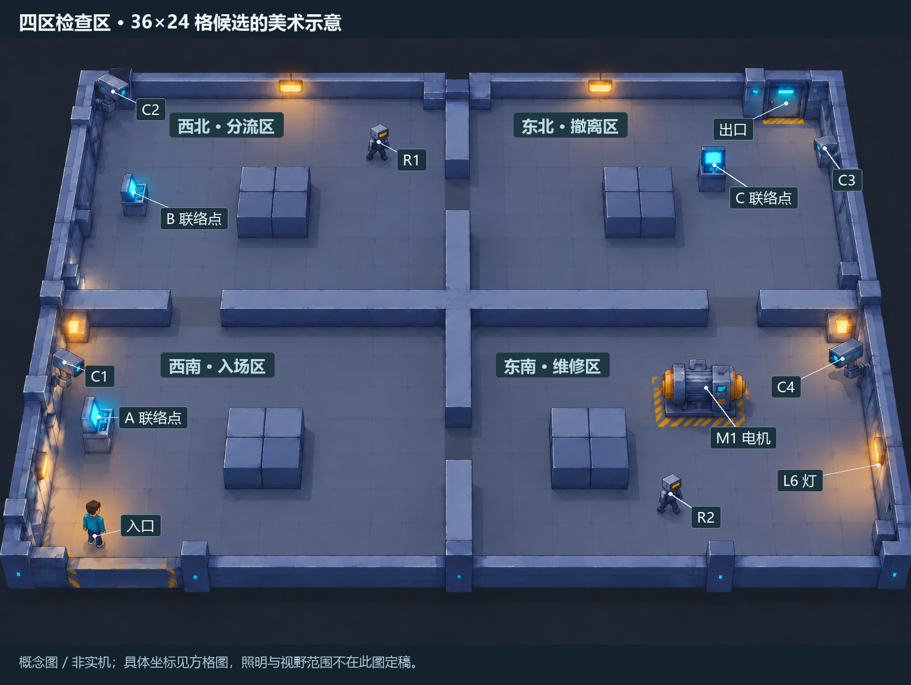
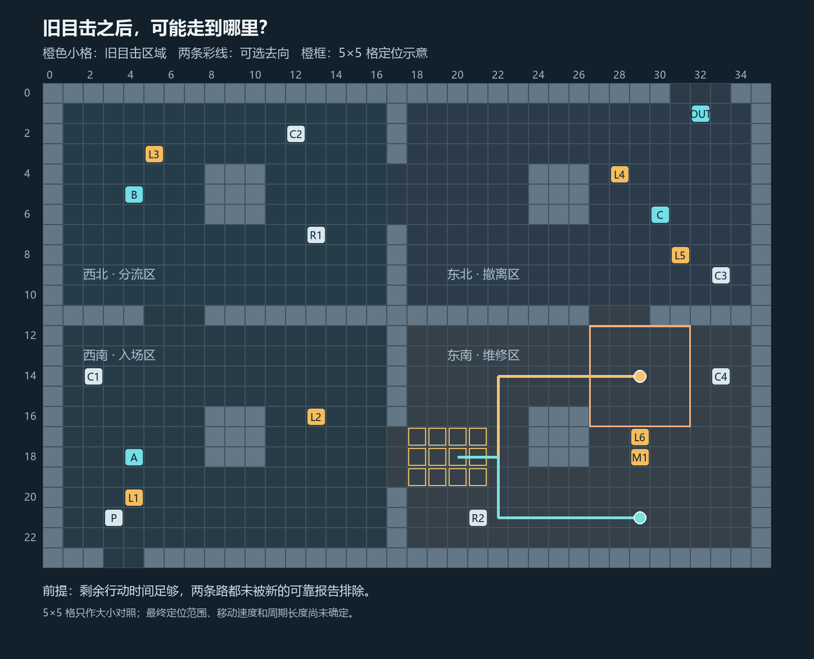
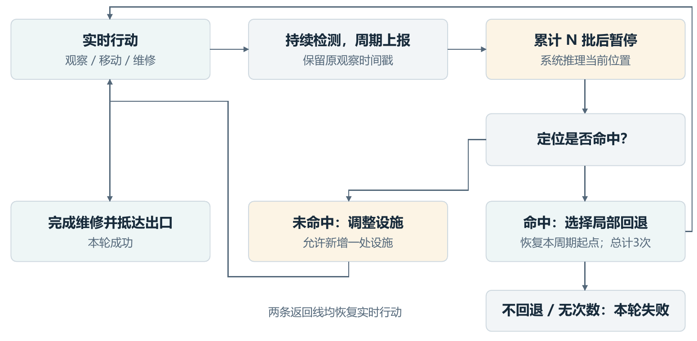
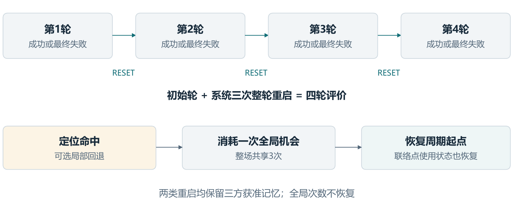

# 《请本人到场》预赛玩法框架 v0.3

完整方案见 [可编辑稿](../submissions/AI_PLAY_72H_预赛方案_v0.3.md)及 [PDF](../submissions/AI_PLAY_72H_预赛方案_v0.3.pdf)。本版扩大地图并压缩重复说明；规则仍按当前设计 Spec。

## 玩家要做什么

亲自走进检查区，修好电机，再抵达出口。地图里能看清灯、摄像头、机器人和设备代号。到联络点后暂停，把路线和现场描述给没有地图的个人助手，请它调整少量设备，随后恢复行动。

摄像头和机器人不会追人。它们留下带时间戳的报告，城市系统每隔若干批次猜一次玩家当前位置；猜错会加强监控，猜中则玩家可用局部回退补救。

## 三方各管什么

| 主体 | 所知与动作 |
| --- | --- |
| 玩家 | 看现场、描述位置、选择路线、移动和维修。 |
| 个人助手 | 没有地图或画面，依据描述追问和比较办法，通过专属接口改灯或摄像头；每次联络最多1–2个改动。 |
| 城市系统 | 从真实报告推断位置，猜错后调整设备并可新增设施；不能直接读取玩家坐标。 |

## 地图怎样支持这些动作

先按36×24格候选安排四个相通分区，3个联络点、1台电机、4台摄像头、6盏灯和2台机器人。入口在西南、维修在东南、出口在东北。两侧通路和区内遮挡提供不同去向。所有位置同层，实时移动，无跳跃；实机拟跟随角色平移视角。

旧目击只能说明当时的位置。若之后有足够时间移动、两条路也没有被新报告排除，就可能留下两个无法被同一定位框同时覆盖的落脚点。图中5×5格只作对照，尚未决定正式定位范围。若最新目击或维修事件指出当前位置，系统仍可能猜中。单电机ID也透露位置，不能仅靠省略坐标隐藏。

## 行动、联络与重启

每个联络点每个完整轮次只会话一次。联络和系统推理均暂停全部游戏计时；同一设备控制项按最后一条有效指令覆盖。助手不能改写已有报告。

初始轮与系统3次整轮RESET共4轮；玩家另有整场共享3次局部回退，回到当前定位周期起点。联络点使用状态随快照恢复：快照中未用就能重新会话，已用则仍然已用。三方保留各自获准记忆；次数和已结算成绩不恢复。回退后仍须到可用联络点讨论。

## 先验证什么

一张地图复用四轮，控制72小时内容量。先看维修是否有可行的进退窗口、旧报告后是否真的有多个去向、有限干预是否值得讨论，再调定位范围和上报节奏。地图、设备数量、示意定位框与10分钟体验均未经过可玩验证。
