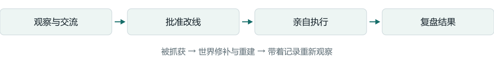
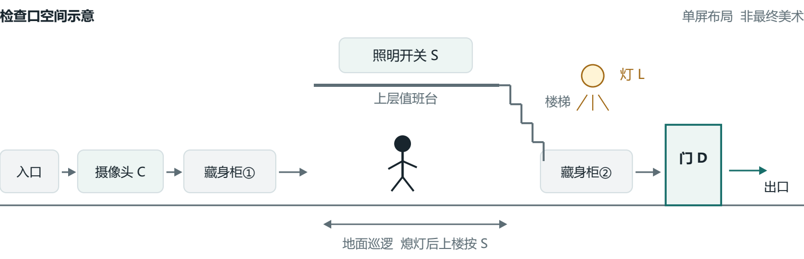
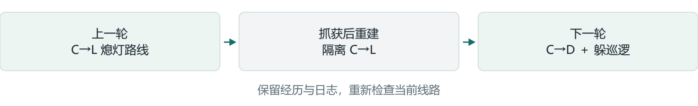

# AI PLAY 72H 游戏赛道预赛方案

项目名称 请本人到场

版本 V0.1　2026年11月13日

## 一 预赛信息卡

| 项目 | 内容 |
| --- | --- |
| 队名 | nekoToken |
| 意向赛道 | AI原生游戏 |
| 核心摘要 | 玩家潜入会在抓获后重建的检查口，与自己的 AI 助手交换现场信息、改接安防线路，在世界修补旧办法后共同寻找新通路。 |
| 队伍人数 | 2人（含队长） |
| 队长信息 | 王嘉璐；邮箱、手机号待填写 |
| 成员介绍与分工 | 王嘉璐（队长）、董骏豪（队员）；职责分工、联系方式待补充。 |
| 团队能力与过往作品 | 由成员补充真实相关经历及作品链接 |

## 二 方案成果展示

### 1 赛题理解

我们把 RESET 设计成一次可解释的重新出题：失败后，玩家与助手保留经历和日志，世界根据上一轮暴露的安防事件修补一种办法。玩家下一次需要重新观察、讨论和行动，而非机械照搬旧解。

目标玩家是喜欢机关解谜与轻度潜入、愿意尝试 AI 协作的玩家。我们希望改善两种体验：失败后只重复固定操作，以及 AI 只提供对白却不参与规则。助手的输出会改变设备连接，效果由玩家实际触发和验证。

### 2 具体方案说明

#### 2.1 玩法框架

作品拟采用 Godot 制作单屏横版潜入解谜。玩家负责现场观察、走位、躲藏和触发设备；个人 Agent 读取线路与维护规则，结合玩家反馈提出并执行经批准的改线；世界 Agent 仅在抓获后的重建时选择合法修补。目标是角色亲自越过出口，开门本身不算通关。

每次合作围绕同一个通行问题：观察现场 → 交换信息 → 协商方案 → 批准改线 → 手操执行 → 复盘结果。目标首玩体验约8至10分钟；作品当前处于方案阶段，实际时长和效果将在原型中验证。

<!-- PAGEBREAK -->

#### 2.2 关卡与操作

检查口的地面有摄像头、两处藏身柜、巡逻区和安保门；上层只有一处值班台，通过楼梯连接地面。上层不直通出口。守卫平时在地面巡逻，照明突然熄灭时会上楼按开关，尝试恢复照明。

| 设备 | 初始作用 | 可利用的连接 |
| --- | --- | --- |
| 摄像头 C | 发现玩家时触发警报 | 改接到灯 L 或门 D |
| 开关 S | 被按下时切换照明 | 改接到门 D |
| 走廊灯 L | 照亮地面通道 | 熄灭后引起守卫检查 |
| 安保门 D | 保持关闭 | 收到信号后本轮常开 |

玩家使用 A/D 移动、W/S 上下楼、E 躲藏或按开关。Tab 打开助手对话并暂停现场，网络等待不占用潜入时机。每个信号源同时只接一个目标；接线不会直接触发设备。

#### 2.3 典型回合 让守卫在维修时开门

玩家报告“门前有守卫，开关在上层，摄像头后有柜子”。助手读取“照明故障时值班员会按 S”的维护规则，确认上楼会空出地面后，提出两条改线：C 从警报改接 L，S 从 L 改接 D。玩家批准后执行：

| 步骤 | 现场变化与玩家行动 |
| --- | --- |
| 1 | 玩家进入摄像头视野，灯灭，没有报警；随后躲进藏身柜①。 |
| 2 | 守卫离开地面，走上值班台，按 S 尝试恢复照明。 |
| 3 | S 的信号打开 D；灯没有恢复，守卫留在上层短暂检查。 |
| 4 | 玩家确认地面空出、门已打开，离柜穿门，抵达出口。 |

另一条通法是 C 直接接 D。玩家触发开门后，利用两处柜子分段躲巡逻。前者需要组合设备关系，后者准备简单但手操要求更高。玩家自行潜入上层、按改接后的 S 也应有效。

<!-- PAGEBREAK -->

#### 2.4 RESET 改变下一次计划

摄像头仍接警报时发现玩家，或守卫确认抓获玩家，都会触发本区域重建。重建前显示抓获原因；重建后并列显示保留日志与规则变化。玩家首次成功越界即可结束，不安排强制失败。

以熄灯计划为例：玩家过早冲出柜子，在守卫尚未上楼时被抓。世界依据真实设备事件修补 C→L。重启后摄像头不能再控制照明，助手必须重读线路，改用 C→D、结合柜子躲巡逻。

| RESET 清除 | RESET 保留 | 世界允许改变 |
| --- | --- | --- |
| 玩家与守卫位置、灯与门状态、本轮接线 | 个人助手的计划和事件日志、玩家的认知 | 一份完整合法线路配置及变更说明 |

首个原型只做基础配置、修补 C→L、修补 C→D 三种配置。每种至少保留一条通法，修补不无限叠加。世界不能读取私人对话、临场改线，或在角色成功越界后撤销胜利。手动重试仅重开本轮配置，便于比较方案。

#### 2.5 AI 技术路径与创作流程

| 参与方 | 输入与职责 | 边界 |
| --- | --- | --- |
| 玩家侧 Agent | 读取线路、维护文档和重建记录；询问现场信息；提出并提交改线 | 接口不提供守卫实时坐标；不能代走、直接开门或操控守卫 |
| 世界 Agent | 读取公开安防事件摘要；重建时选择合法修补并说明原因 | 输出受配置白名单与程序验证约束 |
| Godot 程序 | 移动、碰撞、视野、照明、信号传播、守卫行为与胜负判断 | 即时操作不等待模型，不把规则裁决交给语言模型 |

游戏拟随包提供玩家侧 skill，说明读取状态、提议改线和确认执行的受控接口；评审可使用同权限的内置助手。改线须经批准、整批校验并校对房间版本，避免部分生效或跨 RESET 误操作。模型超时保留暂停状态，允许重试或切换演示助手。

开发顺序为固定规则灰盒 → 两条通法验证 → 接入个人 Agent → 接入世界修补 → 试玩与导出。守卫采用有限状态机；大模型在规划与重建等离散事件调用。

<!-- PAGEBREAK -->

### 3 方案价值与预期效果

预期体验是“我提供现场观察，助手补足线路知识，我们一起改变通行条件”。成功来自理解与执行；失败留下可用记录，下一轮还需要适应已说明的修补。这些是设计目标，当前尚无试玩数据或量化提升结论。

#### 3.1 72小时内交付什么

一个可独立试玩的桌面 Demo：一屏检查口、四类设备、两处柜子、一处上层值班台与楼梯、一名守卫、两条主要通法、三份重建配置、个人 Agent 接口及演示助手。完成开始、操作提示、抓获、重建、胜利与日志反馈。

| 时段 | 工作重点与可检查产物 |
| --- | --- |
| 0至12小时 | Godot 灰盒，跑通移动、躲藏、守卫、信号触发与一条通法 |
| 12至28小时 | 第二通法、线路图与批准改线、个人 Agent 受控接口 |
| 28至44小时 | 世界 Agent 合法修补、RESET 日志、版本与超时处理 |
| 44至56小时 | 新玩家试玩，调整识别与行动窗口，完成统一美术音效 |
| 56至72小时 | 冻结功能，修复与导出，在独立目录验收，录制演示 |

首个版本不扩展战斗、装备树、整座城市或多 NPC 社交。若进度不足，先缩减美术和辅助表现，保留“手操＋真实改线＋一次可理解的重建”完整循环。

#### 3.2 原型验收方式

检查新玩家能否解释“为什么守卫按开关会开门”；双方能否依据现场反馈修订计划；两条通法与三份配置是否都可通关；非法改线是否拒绝；超时后是否可继续。另将对话助手与固定提示作对照，检验自由协商是否确有价值。

### 4 方案优势与创新点

1. 外部个人 Agent 通过 skill 进入游戏规则。读取、规划和工具执行形成可见结果，玩家仍掌握现场行动和授权。
2. 协作围绕同一条因果链。现场信息与线路关系互补，玩家能够利用守卫已有行为创造通路。
3. RESET 同时保留学习、改变解题条件。世界根据实际事件修补一类办法，助手结合记录重新规划；有限配置让变化可解释、可验证。

基础潜入与线路改接借鉴 Gunpoint；本方案的探索重点是个人 Agent 接入与重建后的协作循环，不宣称首创潜入改线，也不承诺任意生成关卡。

参考资料：[官方预赛模板](https://ccns5xfa64kr.feishu.cn/wiki/JQQwweLoaiEAiHkDpVbcrzUCnSc)、[预赛提交表单](https://my.feishu.cn/share/base/form/shrcndmXiSY2Aq1CRte7p6OvPA9)、[Gunpoint设备改接介绍](https://www.pentadact.com/2013-04-22-gunpoint-gadget-trailer/)。
