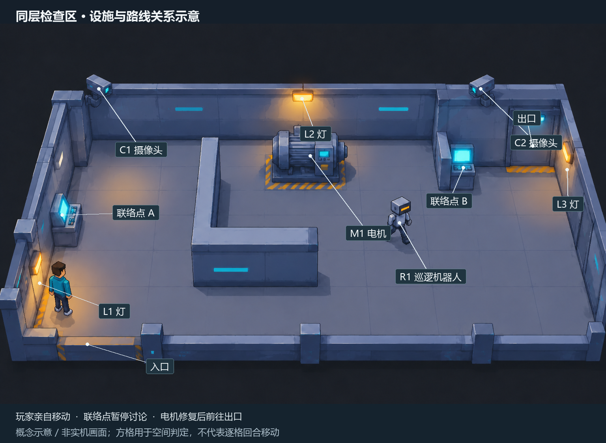
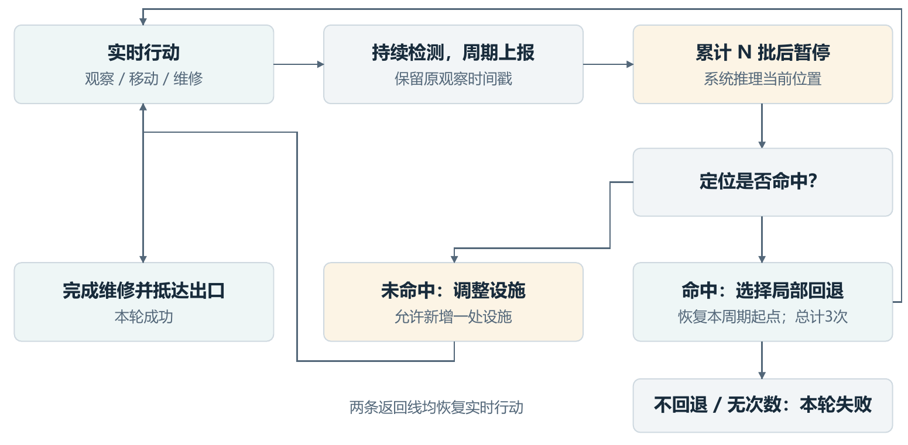
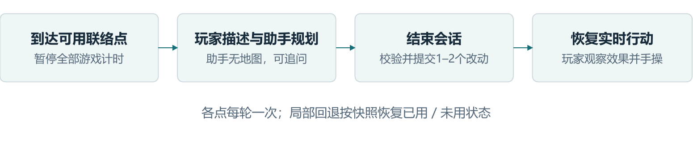
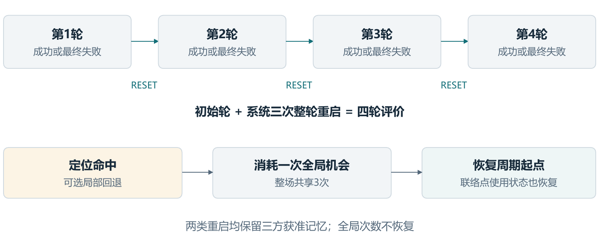

# 请本人到场

AI PLAY 72H 预赛方案 · nekoToken · 2026.11.14 · v0.2 讨论稿

## 一、预赛信息卡

| 项目 | 内容 |
| --- | --- |
| 项目 / 队伍 | 《请本人到场》 / nekoToken |
| 赛道 / 命题 | AI 原生游戏 / 重启 RESET |
| 作品形式 | 高俯角 2.5D 潜入游戏；实时移动；目标体验约 10 分钟 |
| 一句话介绍 | 玩家亲自潜入，向自己的 Agent 描述现场、借它调整设备，躲过城市系统的定位；双方带着记忆重启，再次尝试。 |
| 队长 | 王嘉璐；邮箱、手机号待补 |
| 队员 | 董骏豪；邮箱、手机号待补 |
| 分工与经历 | 两人具体职责、相关经验及作品链接待补 |

## 二、赛题理解

2042 年，AI 已能代人处理大部分生活事务。一位即将被代理永久接替的朋友发来请求：“这次，请你本人来。”玩家带着她的撤回申请，前往交接塔。

演示只取赴约途中的一段自动化检查区：玩家需要修复电机，再抵达出口。自己的助手能改动安防设备，却无法代替玩家观察和行走；城市系统则试图从设备报告中找出玩家的位置。

我们想让 RESET 留下一个具体问题：上次的办法，下一次还管用吗？玩家能回退一次失误，系统也会重新配置检查区。场景重来，三方仍记得发生过什么。目标受众是喜欢潜入、短流程解谜和时间循环的玩家。

图示为方案示意，采用赛博像素三渲二、高俯角 2.5D；地图为同层方格，无跳跃和高低差。画面不代表已完成的游戏。

<!-- page-break -->

## 三、具体方案说明

### 设计点一：设备看见你，系统还要找出你

玩家实时移动、观察、绕开视野并维修电机。摄像头和机器人持续检测，报告按固定节奏批量上传，保留观察发生时的时间戳。每累计 N 批上报，游戏暂停，系统 Agent 根据已有报告猜测玩家当前所在的一片坐标区域；程序用暂停时的位置判定命中。

被设备看见只会留下记录。系统定位命中后，玩家可以消耗局部回退补救；不回退或次数用尽，本轮才记失败。修复电机并抵达出口，则本轮成功。

行动阶段还可在可用联络点发起暂停会话，流程见“设计点二”。系统推理和联络会话都冻结游戏时间，包括设备运动、灯的持续时间、冷却和定位倒计时；两种暂停依游戏流程分别发生。

### 场景中只有几种简单设施

| 设施 | 玩家看到什么 | 对玩法的影响 |
| --- | --- | --- |
| 灯 | 按格覆盖的亮区、暗区 | 每格只有亮或暗；关灯有时长、冷却及同时关闭数量限制 |
| 摄像头 | 朝向及扫描范围 | 在规定视野内观察；首版固定距离、瞬时夹角和扫描速度，调整朝向或扫描区间 |
| 巡逻机器人 | 当前位置、固定视野和巡逻运动 | 按系统指定范围巡逻、采集信息；不追逐或自行抓人 |
| 联络点 | 可用或已用状态 | 到达后可暂停，与个人助手会话 |
| 电机 / 出口 | 维修进度及出口位置 | 维修也产生上报；完成维修并抵达出口即本轮成功 |

视觉报告分为“有人、无人、无法确定”。照明、视野及遮挡共同决定能否可靠观察；暗处无法判断时上报“无法确定”。“有人”对应有限区域，系统需要结合多个设备及时间判断，不能直接读取玩家坐标。

系统每次猜错，可以调整设备，并获得新增一处设施的机会。拖得越久，之后的行动越难安排。原型拟用预设合法位置和数量上限控制新增范围；新增灯会缩小暗区，新增摄像头只扩大有照明区域的观察覆盖。

<!-- page-break -->

### 关卡示意：观察、联络、维修、撤离

示意图使用两个联络点、一台电机和少量监控设施，说明它们在一次行动中的关系；数量和位置不作为最终关卡承诺。方格用于描述空间和计算范围，玩家仍连续移动。

### 一段可能发生的行动

1. 玩家从入口观察设备代号，发现电机 M1 附近有照明，摄像头 C1 会扫过接近路线，机器人 R1 正在右侧巡逻。
2. 到达联络点 A 后，玩家说明想先修电机，描述 C1、灯与电机的相对位置。助手据此比较关灯和调整扫描方向的作用，并询问会影响路线选择的缺失信息。
3. 会话结束，助手提交有限改动。玩家看见设备变化，亲自利用窗口接近电机；维修也留下事件记录，撤离时仍需观察机器人和扫描方向。
4. 系统按周期暂停推理。它可能依据较早的目击猜测维修区；如果玩家已经离开，定位落空，系统便调整监控并有机会新增设施。
5. 玩家视现场决定继续撤离，或到尚未使用的联络点 B 更新计划。修复完成并抵达出口，本轮成功；若定位命中，可以使用剩余局部回退。

重点是利用一次设备改动创造的窗口，完成接近、维修与撤离。窗口够不够用，要在原型中结合维修时长和报告粒度调整。

<!-- page-break -->

### 设计点二：玩家说明现场，助手提出办法

个人助手通过随游戏提供的 skill 和受控接口接入。它知道有哪些合法操作，完全看不到地图、实时画面和设备空间分布。设备代号在哪里、扫描哪条路、玩家准备去哪，都要通过玩家的描述建立对应关系。

玩家掌握观察与移动；助手负责理解描述、追问关键条件、比较干预方案，并调用玩家手操无法使用的设备接口。玩家离开联络点后，要继续观察并执行，助手不常驻跟随操作。

### 一次会话的例子

玩家：“我在 A，准备先修 M1。C1 会扫过通向电机的路，L2 照着电机，机器人现在在右边。”

助手：“先确认一下：去电机必须经过机器人面前吗？如果可以从左侧绕过去，我建议先把 C1 的扫描转离接近路线，把另一次改动用于维修区的照明。”

玩家：“左侧能绕，L2 也只照电机这一段。”

助手：“那就调整 C1 的扫描区间，并短时关闭 L2。恢复后你沿左侧接近；灯恢复照明后，仍要按现场变化决定继续还是撤离。”

例子按一次会话允许 2 个改动说明策略过程；灯状态、摄像头朝向或扫描区间是首版拟开放的操作。具体合法参数由游戏校验。关灯或转向影响之后能否形成新鲜观察，已经产生的报告和时间戳保持原样。

### 联络与设备控制的限制

- 每个联络点在每个完整轮次中只能会话一次，各点分别计算。每次会话最多提交 1–2 个改动；游戏联络窗口另有限制对话轮数和内容量。
- 对同一设施的同一控制项，最后一条有效指令覆盖前一条。设置保持到再次被修改，灯时长、冷却及 RESET 等规则仍生效。
- 系统只在定位猜错后的暂停阶段调度；助手在联络结束后提交。系统可改更多设施，助手只能做少量干预。

“过度依赖”的代价落在这些取舍里：把本能绕开的设备也交给助手处理，可能占掉同次会话中更重要的改动；离点后也无法随时追加指令。剩下的路要靠观察和手操完成。求助本身不直接扣成失败，这种资源取舍是否成立，需要关卡试玩验证。

<!-- page-break -->

### 设计点三：你能回退，系统也会重启

首版按四轮短挑战组织。初始轮结束后，系统还有三次整轮 RESET，根据已获准的历史记录调整下一轮合法配置。某轮失败仍继续后面的轮次，最后按整场表现评价；评分方向为成功情况、用时和消耗，权重后续细化。

玩家另有整场共享的三次局部回退。系统定位命中时，可回到本次定位行动周期的起点；不是任意选择时间点，也不是重开整轮。玩家、个人助手和系统均保留各自获准的历史记忆，系统重启也不会清除个人助手的记忆。

| 内容 | 玩家局部回退 | 系统整轮 RESET |
| --- | --- | --- |
| 玩家、设备、计时及维修进度 | 恢复本定位周期起点快照 | 按下一轮合法配置重建，维修重新开始 |
| 当前有效报告 | 恢复快照对应的报告 | 开始新一轮报告序列 |
| 联络点使用状态 | 恢复快照里的已用 / 未用标记 | 各联络点重新可用 |
| 三方获准记忆 | 保留 | 保留 |
| 全局回退次数、已结算成绩 | 不恢复 | 不恢复 |

例如，快照在使用 A 之前，回退后到 A 还能重新会话；快照中 A 已用，就仍然已用。旧对话保留为经验，被撤销的设备改动则按快照恢复。玩家仍须到达可用联络点才能重新讨论。

重试因此会改变后续选择：玩家和助手知道上一条路线为什么失效，系统也记得它在被撤销分支里获准观察到的情况。历史记录须标明所属轮次与尝试，不能把旧目击冒充当前情报。下一次进入相似现场，三方可能作出不同决定。

<!-- page-break -->

## 四、方案价值与预期效果

我们希望做出一种短流程潜入体验：玩家观察到的设备状态能直接影响讨论；对话形成的计划又能落实为场景里的变化。系统的定位结果让每段行动有结算节点，RESET 则给双方一次带着经验改变办法的机会。

### 72 小时内拟完成的原型

使用 Godot 制作一张同层方格地图，包含入口、联络点、电机、出口及少量灯、摄像头和巡逻机器人。完成实时行动、确定性感知、带时间戳的批量报告、系统定位、助手受限改动和双重 RESET，目标整场约 10 分钟。

游戏程序负责移动、视野、计时、快照、命中判定和修改校验。模型在联络与周期推理节点参与：个人助手理解玩家描述、提出干预；系统 Agent 综合报告、定位并调度设备。对话和推理暂停，避免网络等待改变现场状态。玩家侧 skill 说明接口及权限，与开发使用的 skill 分开交付。

| 时段 | 主要工作 | 可检查的结果 |
| --- | --- | --- |
| 0–12h | 方格场景、移动、电机、出口、设备基础行为 | 能亲自走完一条任务路线 |
| 12–30h | 感知、时间戳报告、周期暂停及定位 | 系统依据授权报告猜测，程序判定结果 |
| 30–46h | 联络点、玩家侧 skill、助手改动与覆盖 | 一次描述能形成场景中可见的合法改动 |
| 46–58h | 局部快照、整轮 RESET、记忆与轮次结算 | 状态按规则恢复，三方经验继续保留 |
| 58–72h | 调整覆盖和时长、美术整理、打包与演示 | 跑通完整体验并核对约 10 分钟目标 |

这是两人开发的阶段安排，具体职责待两位成员确认。优先验证三件事：玩家能否说清现场、助手的少量改动是否值得讨论、重启后是否会产生有意义的新选择。当前未完成可玩原型，体验时长、难度及模型推断效果尚待验证。

## 五、方案优势与创新点

- 个人 Agent 进入操作流程：玩家负责提供现场信息，助手以专属接口改设备，效果需要玩家亲自利用。
- 系统 Agent 通过时间不同、空间有限的真实报告推理位置，再调整监控。AI 的判断会改变下一段行动条件。
- 局部回退和系统重启共用一套“现场恢复、记忆保留”的规则。同一张小地图可以承载双方连续学习的过程，控制 72 小时的内容制作量。

预赛图为概念示意。具体参数、接口字段和最终布局在原型阶段细化。

方案依据：团队截至 2026.11.14 的讨论；赛事材料结构参照 2026.11.13 留存的官方模板。世界观与故事素材取自团队提供的《游戏背景 v1》及《请本人到场》。
