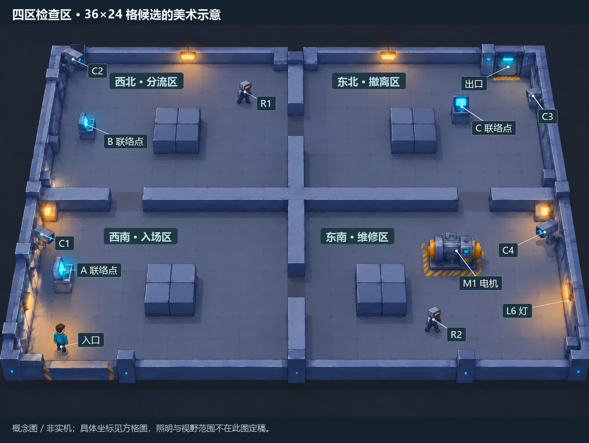
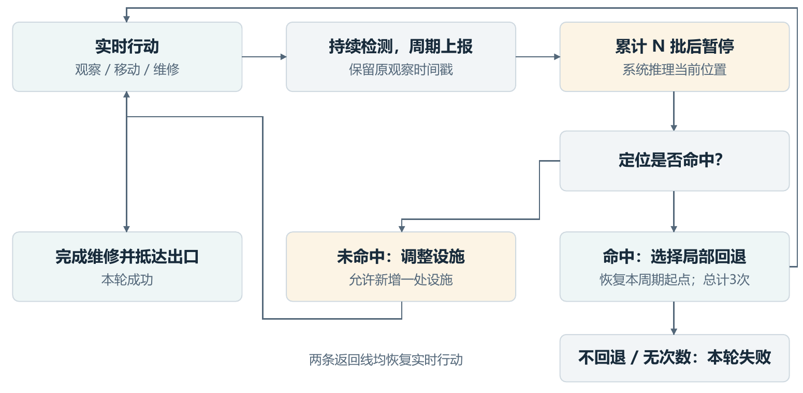
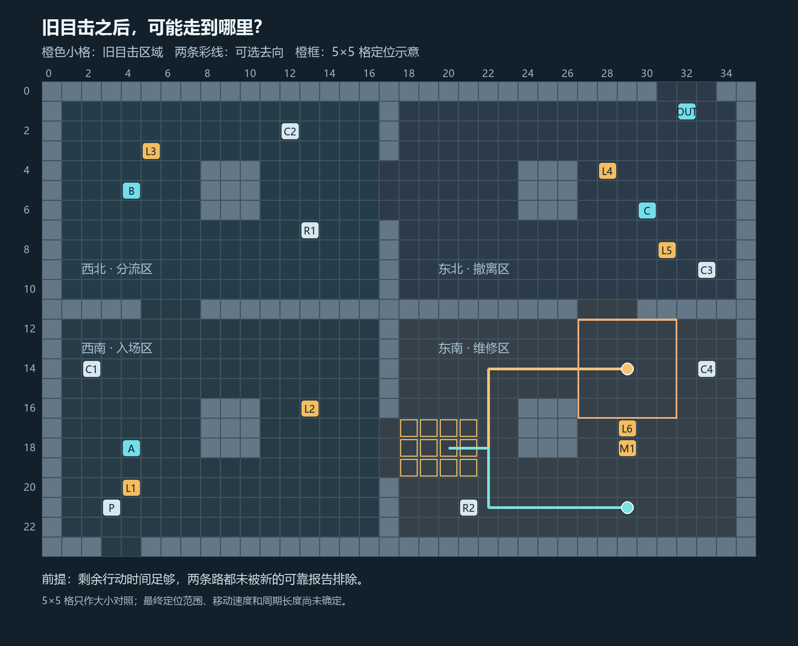
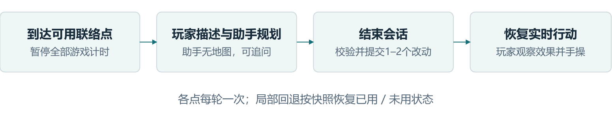
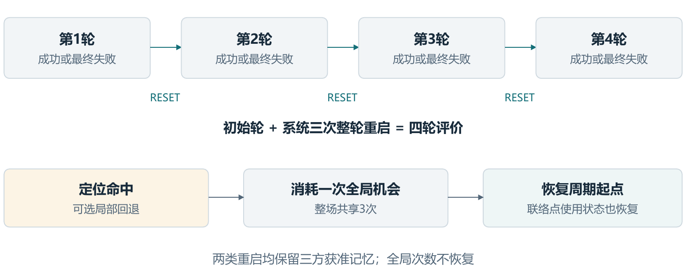

# 请本人到场

AI PLAY 72H 预赛方案 · nekoToken · 2026.11.14 · v0.3 讨论稿

## 一、预赛信息卡

| 项目 | 内容 |
| --- | --- |
| 项目 / 队伍 | 《请本人到场》 / nekoToken |
| 赛道 / 命题 | AI 原生游戏 / 重启 RESET |
| 作品形式 | 高俯角 2.5D 潜入游戏；实时移动；目标体验约 10 分钟 |
| 一句话介绍 | 你亲自潜入检查区，把现场描述给自己的 Agent，请它调整设备；城市系统从报告里找你。重启之后，你、助手和系统都记得上一次发生的事。 |
| 队长 | 王嘉璐；邮箱、手机号待补 |
| 队员 | 董骏豪；邮箱、手机号待补 |
| 分工与经历 | 两人具体职责、相关经验及作品链接待补 |

## 二、赛题理解

2042 年，AI 已能代人处理大部分生活事务。一位即将被代理永久接替的朋友发来请求：“这次，请你本人来。”玩家带着她的撤回申请，前往交接塔。

Demo 发生在途中一处自动化检查区。玩家要修好电机，再走到出口。自己的助手能调整灯和摄像头，却看不到地图，需要玩家描述现场。城市系统掌管监控，定期判断玩家藏在哪里。

RESET 让双方有机会重来，也让旧办法变得不可靠。玩家可以回退一次失误，系统则会在整轮结束后重新布置设备；三方都保留各自经历。我们希望吸引喜欢潜入、短流程解谜和时间循环的玩家。

图示为概念图，采用赛博像素三渲二、高俯角 2.5D。所有可行走位置同层，无跳跃和高低差。

<!-- page-break -->

## 三、具体方案说明

### 设计点一：设备报告过去，系统判断现在

玩家实时移动、绕开视野并维修电机。摄像头和机器人持续观察，按固定节奏批量上报，每条记录保留观察发生的时间。每累计 N 批报告，游戏暂停，系统 Agent 猜测玩家当前所在的一片坐标区域。程序用暂停时的真实位置判定命中。

被设备看见只会留下记录。定位命中后，玩家可以消耗一次局部回退；不回退或机会用尽，本轮失败。修好电机并抵达出口，本轮成功。

行动时也可到联络点发起会话。联络和系统推理都暂停游戏，设备运动、灯的时长、冷却、上报和定位倒计时全部冻结。两种暂停按流程分别发生。

### 场景中只有几种简单设施

| 设施 | 玩家看到什么 | 对玩法的影响 |
| --- | --- | --- |
| 灯 | 按格覆盖的亮区、暗区 | 每格只有亮或暗；关灯受持续时间、冷却和同时关闭数量限制 |
| 摄像头 | 朝向及扫描范围 | 固定距离、瞬时夹角和首版扫描速度；可以调整朝向或扫描区间 |
| 巡逻机器人 | 位置、固定视野及运动 | 按系统指定范围巡逻并观察，不追逐或自行抓人 |
| 联络点 | 可用 / 已用状态 | 到达后暂停，与个人助手会话 |
| 电机 / 出口 | 维修进度、出口位置 | 维修产生上报；修复后到达出口即本轮成功 |

视觉报告分为“有人、无人、无法确定”。只有照明、视野和遮挡条件允许时，设备才能可靠观察。“有人”指向一片有限区域；“无法确定”不能当成“无人”。系统不直接读取玩家坐标，要结合报告的时间与空间判断。

系统每次猜错，可以调整现有设备，并获得新增一处设施的机会。拖得越久，可用路线可能越少。原型拟把新增设施放在预设合法位置，并设数量上限；新增灯改变照明，新增摄像头扩大有照明区域的观察覆盖。

<!-- page-break -->

### 关卡示意：一张可以绕行的检查区

候选地图按 36×24 格安排。隔墙分出四区，通口让它们连成环路。玩家可以从不同方向接近维修区，维修后也有直接撤离或向另一侧绕行的选择。区内再用少量遮挡块切断长视线。

| 分区 | 放置内容与作用 |
| --- | --- |
| 西南入场区 | 入口、联络点 A。先观察设备，决定从哪一侧进入后续区域。 |
| 西北分流区 | 联络点 B、遮挡块和巡逻。提供通向东北的另一条路线。 |
| 东南维修区 | 电机 M1、监控和遮挡块。维修需要驻留，接近和离开要一起计划。 |
| 东北撤离区 | 联络点 C、出口。与维修区和西北区相通，撤离时仍要观察覆盖。 |

示意采用 3 个联络点、1 台电机、4 台摄像头、6 盏灯和 2 台机器人。尺寸与数量都是候选；概念图表现美术和分区，具体格坐标见下一页。实机拟随角色平移视角，保证设备代号和扫描边界看得清。

扩大空间的目的，是让旧目击之后存在多个去向。它不能保证安全：如果设备一直可靠地看着玩家，或最新报告刚指出玩家所在区域，系统依然有机会猜中。

<!-- page-break -->

### 一段行动：同一次旧目击，留下两种去向

图中橙色小格是一次较早的目击区域，两条彩线是绕过遮挡块的可能走法，橙框只示意一次 5×5 格定位的大小。方格用于描述和判定，玩家仍连续移动。

1. 玩家在 A 联络，描述南侧通口、C4、L6 与 M1 的关系。助手确认机器人是否挡住接近路线，再比较调整摄像头和关灯的作用。
2. 会话结束，合法改动生效。玩家穿过南侧通口，被设备留下一次“有人”记录，随后进入遮挡后的区域。
3. 如果剩余行动时间足够，且没有新的可靠报告排除某条路，玩家可以绕遮挡块北侧，也可以走南侧。到定位时，两处可能位置不必落在同一个定位框里。
4. 系统根据已有记录选择一个范围。猜错就调整监控并可能增加设施；玩家继续接近电机、维修和撤离。猜中则选择局部回退或接受本轮失败。

维修也会留下时间记录。只放一台电机时，M1 的代号就能指明维修位置；玩家应安排维修后往哪里走。若定位发生在维修驻留期间，系统可能据此猜中。报告粒度、维修时长与定位节奏需要在原型中一起调整。

这里还要验证两个条件：不同去向是否来得及到达，以及新的“无人 / 有人”报告是否已经排除了其中一处。地图大小、定位范围和行动时间必须配套，不能只靠增加格数降低难度。

<!-- page-break -->

### 设计点二：玩家描述现场，助手帮忙改设备

个人助手通过随游戏提供的 skill 和受控接口接入。它知道可以调用哪些操作，完全看不到地图、实时画面和设备空间分布。设备代号在哪里、覆盖哪条路、玩家准备去哪，要由玩家说明。

助手据此追问缺失条件、比较办法，再调用玩家手操不能使用的接口。玩家负责观察变化、亲自移动和维修。离开联络点后，不能继续随时追加指令。

### 一次会话的例子

玩家：“我在 A，要从南侧通口去修 M1。C4 能扫到电机，L6 照着它，机器人现在在电机南边。”

助手：“机器人会挡住你去电机的路吗？从遮挡块北侧绕，能避开它吗？”

玩家：“能从北侧绕。C4 还会扫到那条路，L6 主要照电机附近。”

助手：“那就把 C4 的扫描转离接近路线，短时关闭 L6。你从北侧过去。关灯时间有限，维修后还得看机器人在哪，再决定从哪边离开。”

例子按一次会话允许 2 个改动说明。首版拟开放灯状态、摄像头朝向或扫描区间，具体参数由游戏校验。改动只影响未来观察，已生成的报告、结果和时间戳不能改写或删除。

### 联络与设备控制的限制

- 每个联络点在每个完整轮次中只能会话一次，各点分别计算。每次最多提交 1–2 个改动；另设对话轮数和内容量限制。
- 同一设施的同一控制项，最后一条有效指令覆盖前一条。设置保持到再次修改，灯时长、冷却和 RESET 等规则仍有效。
- 系统只在定位猜错后的暂停阶段调度；助手在联络结束后提交。系统能改更多设施，助手一次只能做少量干预。

依赖助手的代价来自有限机会。如果把自己能绕开的设备也占用一次改动，接下来更难处理的设施就可能来不及调整；到不了下一个可用联络点，也无法继续求助。求助本身不判负。这种取舍能否成立，需要在具体路线中试玩。

<!-- page-break -->

### 设计点三：你能回退，系统也会重启

Demo 按四轮短挑战组织。初始轮结束后，系统有三次整轮 RESET，根据自己获准保留的记录调整下一轮设备配置。某轮失败仍继续后面的轮次，最后按整场成功情况、用时和消耗评价，评分权重后续细化。

玩家另有整场共享的三次局部回退。定位命中时，可以回到本次定位行动周期的起点。玩家、个人助手和系统均保留各自获准的历史记忆，系统重启也不会清除个人助手的记忆。

| 内容 | 玩家局部回退 | 系统整轮 RESET |
| --- | --- | --- |
| 玩家、设备、计时及维修进度 | 恢复本定位周期起点快照 | 按下一轮合法配置重建，维修重新开始 |
| 当前有效报告 | 恢复快照对应的报告 | 开始新一轮报告序列 |
| 联络点使用状态 | 恢复快照里的已用 / 未用标记 | 各联络点重新可用 |
| 三方获准记忆 | 保留 | 保留 |
| 全局回退次数、已结算成绩 | 不恢复 | 不恢复 |

例如，快照在使用 A 之前，回退后到 A 还能重新会话；快照中 A 已用，就仍然已用。旧对话保留为经验，被撤销的设备改动按快照恢复。玩家仍须到可用联络点才能讨论，旧命令不会自动重新提交。

下一次尝试时，玩家和助手知道上一条路线哪里出了问题，系统也记得自己曾获得的目击和判断。历史记录要标明所属轮次与尝试，不能当成当前情报，也不能借保留记忆读取真实坐标。原来好用的路线可能被加强，玩家需要重新观察。

<!-- page-break -->

## 四、方案价值与预期效果

我们希望玩家会为一次干预讨论具体问题：这次先转摄像头，还是把关灯机会留给维修？路线能否靠走位解决？回退之后，要不要再用同一个联络点？这些选择应当在画面里有可见的结果。

### 72 小时内拟完成的原型

使用 Godot 制作一张分区地图，复用地板、隔墙和现有设备。四轮沿用同一拓扑，调整合法设备配置。候选 36×24 格用于安排路线，不扩展成多张关卡或城市探索，目标整场约 10 分钟。

游戏程序负责移动、确定性感知、带时间戳的批量报告、计时、快照、命中判定和修改校验。模型在联络和周期推理节点参与：助手理解现场描述、提出改动；系统依据报告定位，猜错后调度。两类推理期间都暂停。玩家侧 skill 说明接口和权限，与开发使用的 skill 分开交付。

| 时段 | 主要工作 | 可检查的结果 |
| --- | --- | --- |
| 0–12h | 分区灰盒、移动、电机、出口、设备基础行为 | 能从不同方向接近任务点并完成撤离 |
| 12–30h | 感知、时间戳报告、周期暂停及定位 | 只依据授权报告猜测，程序判定命中 |
| 30–46h | 联络点、玩家侧 skill、助手改动与覆盖 | 描述能转成场景中可见的合法改动 |
| 46–58h | 局部快照、整轮 RESET、记忆与结算 | 状态按规则恢复，三方经验继续保留 |
| 58–72h | 调整覆盖和时长、美术整理、打包与演示 | 检查定位难度、维修风险及完整体验时长 |

这是两人开发的阶段安排，具体职责待成员确认。当前未完成可玩原型，地图连通不等于潜入体验成立；仍需验证旧报告后的可达去向、维修是否必败、少量干预是否值得讨论，以及模型等待是否影响 10 分钟目标。

## 五、方案优势与创新点

- 个人 Agent 参与真实操作：玩家提供现场信息，助手比较办法并改动设备，玩家利用改动完成行动。对话会影响路线选择。
- 敌方 Agent 从设备报告判断位置。报告有真实时间和有限区域，判断结果决定下一段监控如何调整。
- 局部回退和整轮 RESET 都恢复现场、保留各自记忆。双方会根据上一次经历改变办法；四轮复用同一地图，控制内容制作量。

方案依据：团队截至 2026.11.14 的讨论；赛事材料结构参照 2026.11.13 留存的官方模板。世界观与故事取自团队提供的《游戏背景 v1》及《请本人到场》。概念图、候选布局和参数示意均不代表实机效果或试玩结论。
