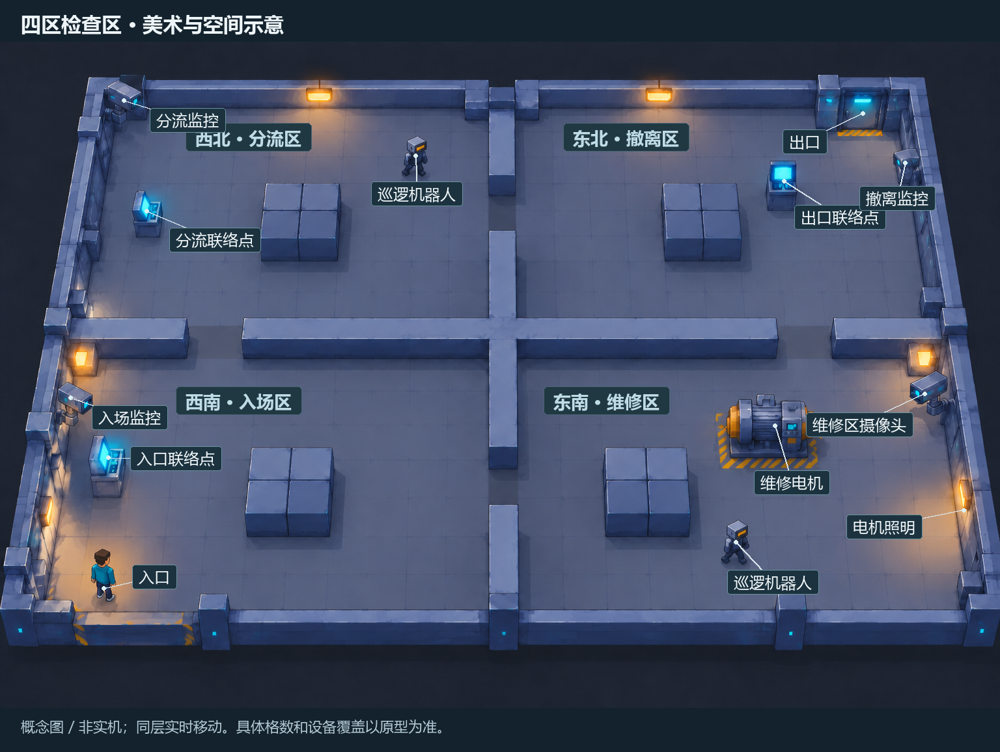
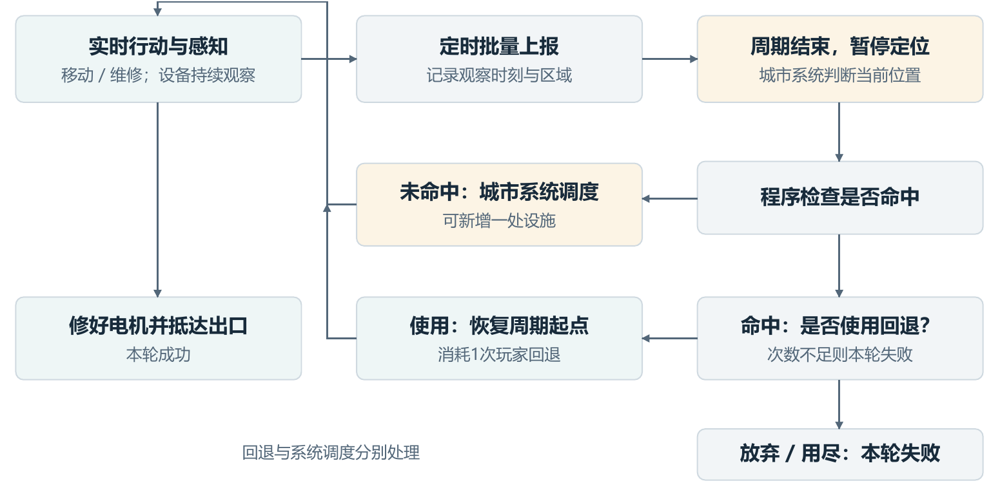
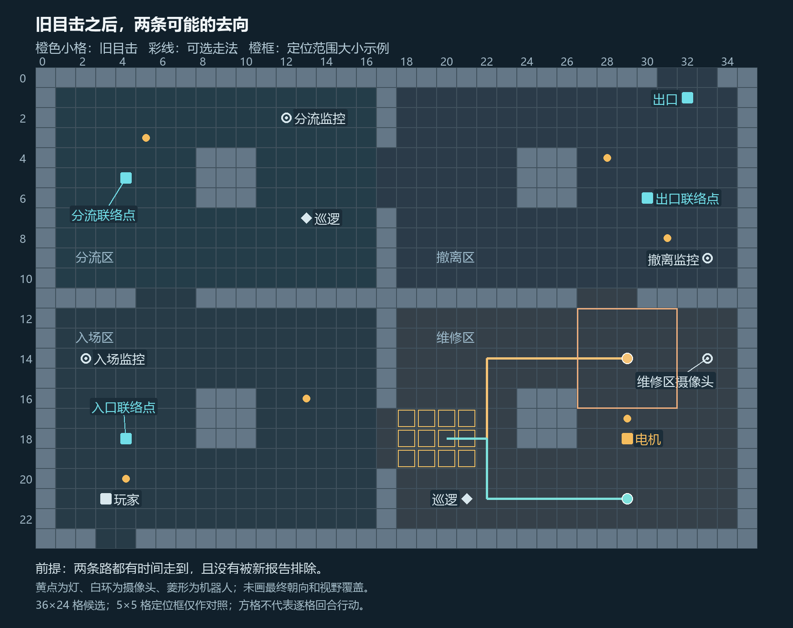
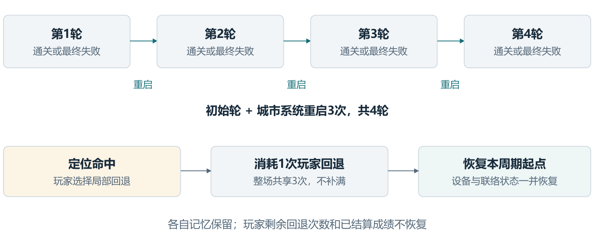

# 请本人到场

AI PLAY 72H 预赛方案 · nekoToken · 2026.11.14 · v0.4 自检修订稿

## 一、预赛信息卡

| 项目 | 内容 |
| --- | --- |
| 项目 / 队伍 | 《请本人到场》 / nekoToken |
| 赛道 / 命题 | AI 原生游戏 / 重启 RESET |
| 作品形式 | 高俯角 2.5D 潜入游戏；实时移动；整场目标约 10 分钟 |
| 一句话介绍 | 玩家亲自潜入，把现场描述给自己的 AI 助手，请它调整监控设备；城市系统从报告中寻找玩家。双方带着各自的记忆重来。 |
| 队长 | 王嘉璐；邮箱、手机号待补 |
| 队员 | 董骏豪；邮箱、手机号待补 |
| 分工与经历 | 两人具体职责、相关经验及作品链接待补 |

## 二、赛题理解

2042 年，AI 已经接管许多日常事务。一位即将被代理永久接替的朋友发来请求：“这次，请你本人来。”玩家带着她的撤回申请，前往交接塔。

Demo 截取途中一处自动化检查区。玩家要亲手修好电机，再抵达出口。个人助手能改设备，却看不到现场；城市系统掌管安防，要靠设备报告判断玩家的位置。玩家既要与助手沟通，也要自己观察和行动。

我们想让重启保留上一次尝试的影响。玩家可以回退失误，城市系统也会在整轮结束后调整设备、重新布置挑战。现场恢复，双方各自记得什么奏效、什么出错。目标受众是喜欢潜入、短流程解谜和时间循环的玩家。

图示为概念图，采用赛博像素三渲二、高俯角 2.5D。所有可行走位置同层，无跳跃和高低差。

<!-- page-break -->

## 三、具体方案说明

### 设计点一：被看见之后，还有机会离开

玩家实时移动和维修，摄像头与机器人同时持续观察。观察记录定时成批上传，注明当时的时间和一片有限区域。每累计固定数量的报告批次，游戏暂停，城市系统判断玩家当前可能在哪，并提交一个固定形状、大小受规则限制的定位范围。游戏程序检查玩家是否落在范围里。

被看见只会留下记录。定位命中后，玩家可用剩余回退机会补救；放弃或用尽机会，本轮失败。修好电机并抵达出口，本轮成功。城市系统知道地图与设备配置，但不能直接读取玩家坐标。

每次定位只判断一次。猜错后，城市系统可以调整设备，并获得新增一处设施的机会，再开始下一段行动。首版拟用预设位置和数量上限控制新增；灯扩大照明，摄像头扩大亮处的观察覆盖。新增设施不额外触发定位。

### 玩家需要读懂的现场信息

| 设施 | 玩家能看到什么 | 基本规则 |
| --- | --- | --- |
| 灯 | 哪些格子亮、哪些格子暗 | 只有亮 / 暗；关灯有时长、冷却和同时关闭数量限制。别的灯仍照着时，该格仍亮。 |
| 摄像头 | 当前扇形视野、扫描方向及摆动边界 | 距离、瞬时夹角和首版速度固定，可调整朝向或扫描区间。尚未扫到不等于确认无人。 |
| 巡逻机器人 | 位置、固定视野和巡逻运动 | 按城市系统指定范围巡逻，不自行追人、检修或抓获。 |
| 联络点 | 本轮可用 / 已用状态 | 到达后可以发起暂停会话。 |
| 电机 / 出口 | 维修进度、出口位置 | 维修也留下报告；完成维修是通关前提。 |

这些设备只按指令执行，没有独立决策。照明、视野和遮挡条件允许时，才能可靠观察。报告分为“有人、无人、无法确定”；未知区域不能记成无人。城市系统需要结合观察时刻、区域及之后可能的移动判断位置，不能把不同时刻的目击简单叠在一起。

<!-- page-break -->

### 关卡示意：四个相通的区域

候选地图为 36×24 格。四区通过隔墙开口连成环路，区内另有遮挡块。玩家可以从不同方向接近电机，维修后也能选择直接撤离，或绕回另一侧。

| 分区 | 内容与用途 |
| --- | --- |
| 西南入场区 | 入口和入口联络点。观察现场，决定走哪一侧。 |
| 西北分流区 | 分流联络点、遮挡和巡逻。提供通向东北的另一条路。 |
| 东南维修区 | 电机、监控和遮挡。维修需要停留，必须同时考虑怎么接近、怎么离开。 |
| 东北撤离区 | 出口联络点和出口。与西北、东南两区相通。 |

示意采用 3 个联络点、1 台电机、4 台摄像头、6 盏灯和 2 台机器人，数量与位置仍是候选。实机拟跟随角色平移视角；未进入画面的设备，要先观察再向助手描述。方案全景图供评审理解布局，不是助手能读取的地图。

灯的覆盖、摄像头当前视野和机器人位置应在画面里清楚显示。设备在游戏内保留唯一标识，方便调用；方案主要用“维修区摄像头”“入口联络点”等名称说明它们的作用。

<!-- page-break -->

### 一次潜入怎样进行

橙色小格表示一次较早的目击，两条彩线表示之后可选的走法。橙框只对照 5×5 格定位的大小，正式范围尚未确定；图中未画最终照明和设备视野。

1. 玩家先观察相关路线，再到入口联络点描述现场。助手根据描述比较改灯与调整摄像头的作用；观察不全时先追问，不替玩家补出地图。
2. 会话结束，改动生效。玩家穿过南侧通口；假设这里留下一次目击，随后两条绕行路线都没有被新报告排除，且剩余时间足够，就可能到达两个无法被同一定位框同时覆盖的位置。
3. 玩家根据当时的视野和巡逻选择走法，接近电机并维修。维修同样上报；只放一台电机时，即使不写坐标，维修事件也会暴露当时的位置。
4. 到定位时暂停。猜错后监控可能改变，玩家恢复行动后重新观察；猜中则选择回退或接受本轮失败。修好电机后继续前往出口，成功或最终失败都会结束本轮。

维修报告描述的应是实际发生的事件，不能伪造或删除。定位恰逢维修停留时，城市系统仍可能猜中。原型要把报告粒度、维修时长、移动距离和定位节奏一起调整，保证有可尝试的接近与撤离窗口。

<!-- page-break -->

### 设计点二：把观察说清楚，让助手选改法

个人助手由玩家自己的 Agent 接入，随游戏提供的接入说明（skill）介绍操作和权限。助手没有地图、实时画面或设备位置，现场信息来自玩家描述。它据此追问、比较办法，并调用玩家手操不能使用的设备接口；玩家负责移动和维修。

### 一次会话的例子

玩家：我刚看过维修区，回入口联络点了。我想绕遮挡块北侧去电机，那条路会被维修区摄像头扫到，设备号是 C4。

助手：你上次观察时，机器人在哪？从这里到电机还要走多远？

玩家：刚才在南侧巡逻，北侧那时能走。但到电机还有一段路，过去时还得再看。

助手：这次先把 C4 的扫描转离北侧通路，不提前关电机旁的灯。现在关灯，等你走过去可能已经恢复了。你先观察着走北侧，到电机旁再看机器人的位置，不能把转向当成整段路都安全。

例子只提交一个改动。助手选择了持续的扫描调整，避开过早消耗关灯时间；它也没有替玩家保证之后的现场。具体朝向和可改参数由游戏校验，建议能否奏效仍需实机验证。

### 会话、额度和指令怎样生效

- 每个联络点每个完整轮次只能会话一次，每次最多 1–2 个改动。各点独立计算，使用一个点不占用下一联络点的机会。
- 联络会话和城市系统推理分别暂停全部游戏时间，包括设备运动、维修、上报、灯时长、冷却和定位计时。助手在会话结束后提交改动，再恢复行动；离点后不能远程追加。
- 同一设备的同一控制项，最后一条有效指令覆盖前一条；未被改写的设置跨定位周期保持。关灯到期、冷却和重启规则仍然有效。
- 游戏内联络窗口限制消息轮数和长度；外部助手的有效提交由接口限额。助手不能改写、删除历史报告或时间戳，首版拟只开放灯和摄像头。

盲目照办的风险是忽略后续变化：灯会重新亮，机器人会继续巡逻，城市系统之后也可能改回摄像头。少量干预不能代替整段路的观察。求助次数多不直接判负，现有额度也不意味着“用得越多就越差”。

<!-- page-break -->

### 设计点三：现场恢复，经历留下

一轮是从入场到通关或最终失败，其中可以经历多次定位。整场共四轮：初始轮结束后，城市系统再进行三次整轮重启，根据已有记录调整下一轮设备配置。某轮失败仍继续后续轮次，最后按成功情况、用时和消耗评价，评分权重后续细化。

玩家另有整场共享的三次局部回退。定位命中后，可以回到本次行动周期的起点，恢复当时保存的现场；不会因此额外获得一次系统调度。

| 内容 | 玩家局部回退 | 城市系统整轮重启 |
| --- | --- | --- |
| 玩家、设备、计时、维修进度 | 恢复当前周期起点的记录，设备增减也随记录恢复 | 同一地图开始新轮，使用下一轮允许的设备配置，维修重新开始 |
| 当前有效报告 | 恢复起点时的报告状态 | 开始新一轮报告 |
| 联络点使用状态 | 恢复起点时的可用 / 已用标记 | 各点重新可用 |
| 各自记忆 | 保留 | 保留 |
| 玩家剩余回退次数、已结算成绩 | 不恢复 | 不恢复 |

入口联络点在起点记录中没用过，回退后就能重新会话；如果已经用过，仍算已用。玩家必须到可用点才能讨论，旧命令不会自动再执行。

记忆也有边界：玩家记得自己见过和做过的事；助手记得玩家描述、对话与操作回执；城市系统记得自己收到的报告及此前的判断和调度。被撤销尝试的记录会标明属于过去，不能冒充当前目击。重启不会让任何一方突然看见原本无权读取的信息。

<!-- page-break -->

## 四、方案价值与预期效果

玩家需要决定这次求助解决哪段风险，以及哪些部分由自己走位处理。对话结束后，摄像头的扫描或灯的状态会在场景中改变，玩家要亲自利用这个变化完成任务。重启后，同一条路可能换了监控安排，上一轮经验可以参考，也需要重新核对。

### 72 小时内拟完成的原型

使用 Godot 制作一张分区地图，复用地板、隔墙和现有设备。四轮沿用同一布局，只改变允许的设备配置。36×24 格及示意数量用于安排路线，最终规模随原型调整。

游戏程序负责移动、视野与照明判定、报告、计时、回退记录和命中检查。两个 Agent 在联络和定位节点参与：个人助手理解描述并调整设备；城市系统推断位置，猜错后调度。接入说明介绍接口与权限，实际限制由程序执行。

| 时段 | 主要工作 | 可检查的结果 |
| --- | --- | --- |
| 0–12h | 地图灰盒、移动与任务路线；试通两个 Agent 的调用 | 能走通任务；模型能按接口返回一次有效结果 |
| 12–30h | 设备观察、报告、暂停定位及命中检查 | 观察有真实时间，城市系统只靠提供的报告猜位置 |
| 30–46h | 联络点、接入说明、助手改动和指令覆盖 | 描述能转成可见改动，离点后不能追加操作 |
| 46–58h | 局部回退、整轮重启、记忆与结算 | 现场按记录恢复，联络机会和剩余次数正确 |
| 58–72h | 调整难度与时长、美术整理、打包演示 | 跑完四轮，检查维修窗口和完整体验时长 |

10 分钟指整场体验，包含四轮、对话、推理等待和回退，当前尚无试玩数据。先验证维修能否完成、绕行是否真有选择、助手的改法是否值得讨论，再根据模型等待和操作时间调整参数。具体分工、模型超时后的处理及单轮时限仍待确定。

## 五、方案优势与创新点

- 玩家的现场描述决定助手能提出什么办法，设备接口把讨论变成实际改动，玩家再亲手完成潜入。
- 城市系统从有时间差的报告判断位置，猜错后重新安排监控。玩家面对的是会依据记录调整的对手。
- 玩家回退和城市重启都保留各自经历，同一张地图支持连续试探与调整，适合控制短流程 Demo 的制作量。

方案依据：团队截至 2026.11.14 的讨论；赛事栏目参照 2026.11.13 留存的官方模板。世界观和故事取自团队提供的《游戏背景 v1》及《请本人到场》。图示为方案材料；布局、设备数量和定位框大小均未经过可玩验证。
