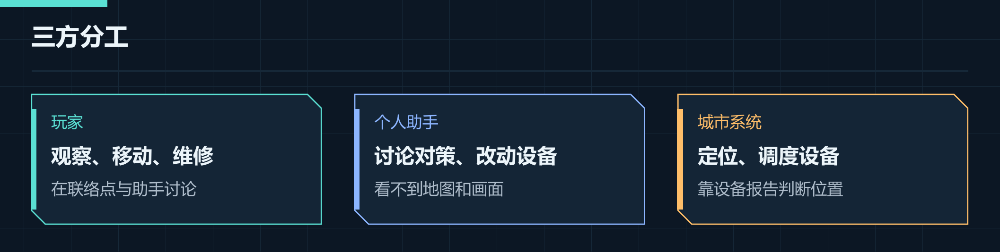
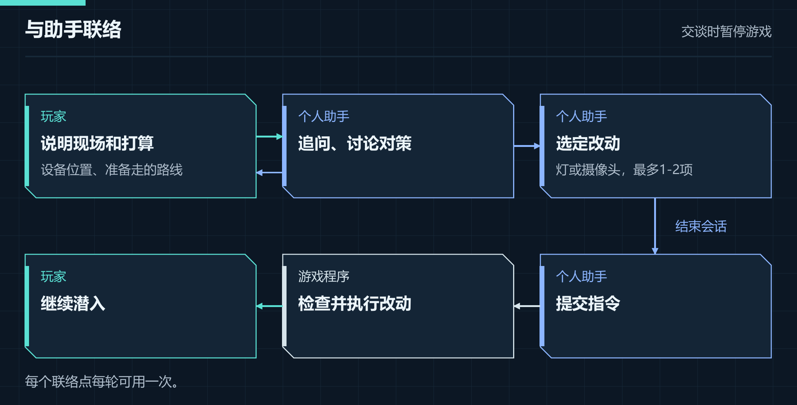
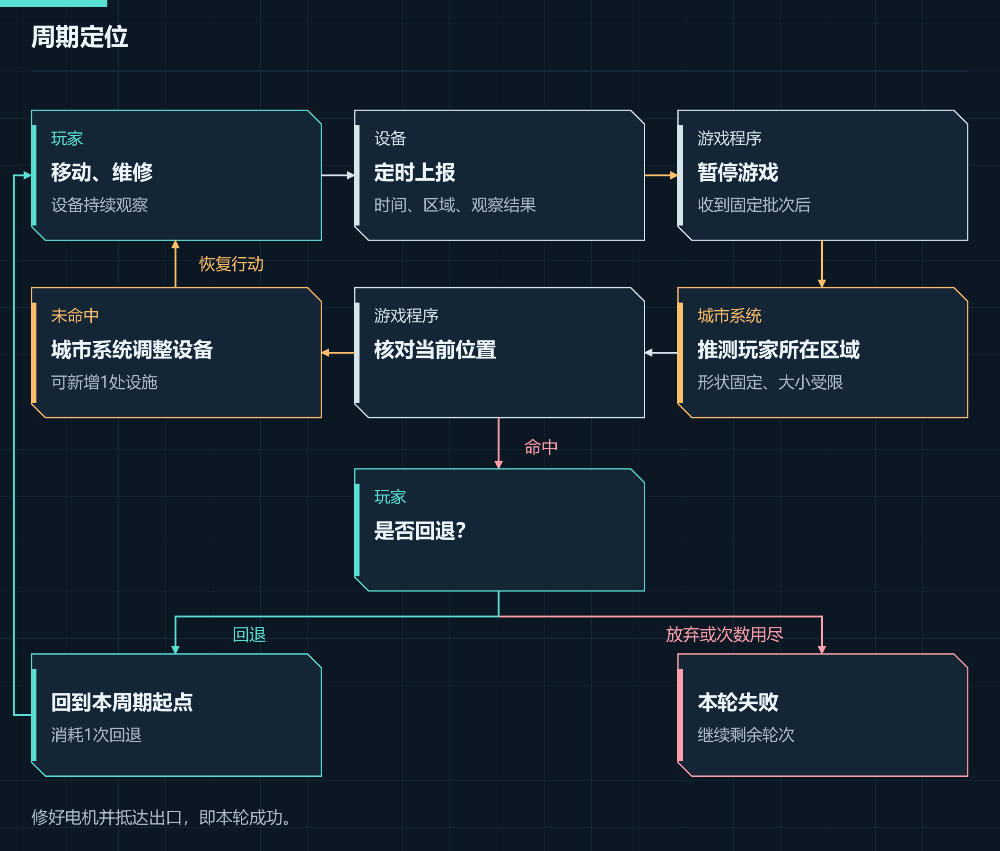
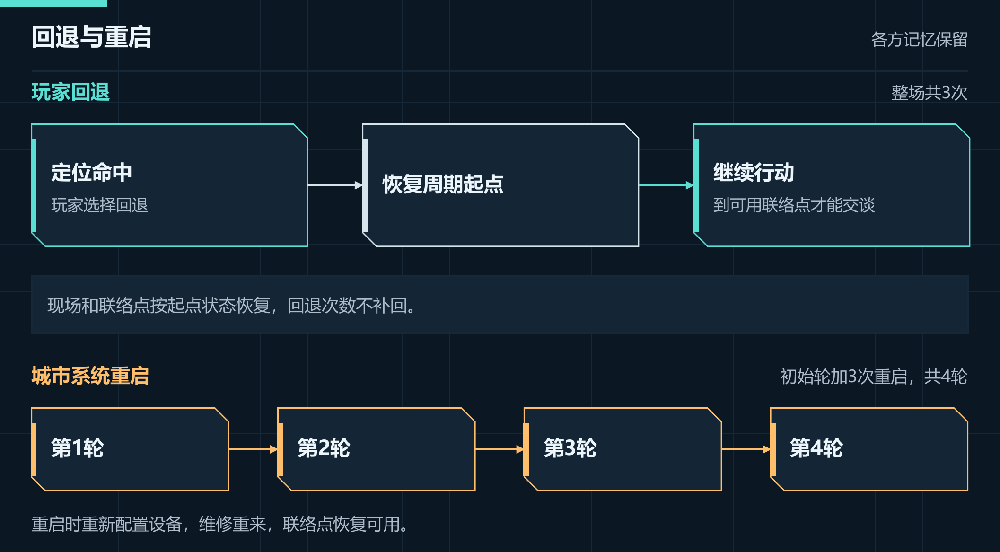
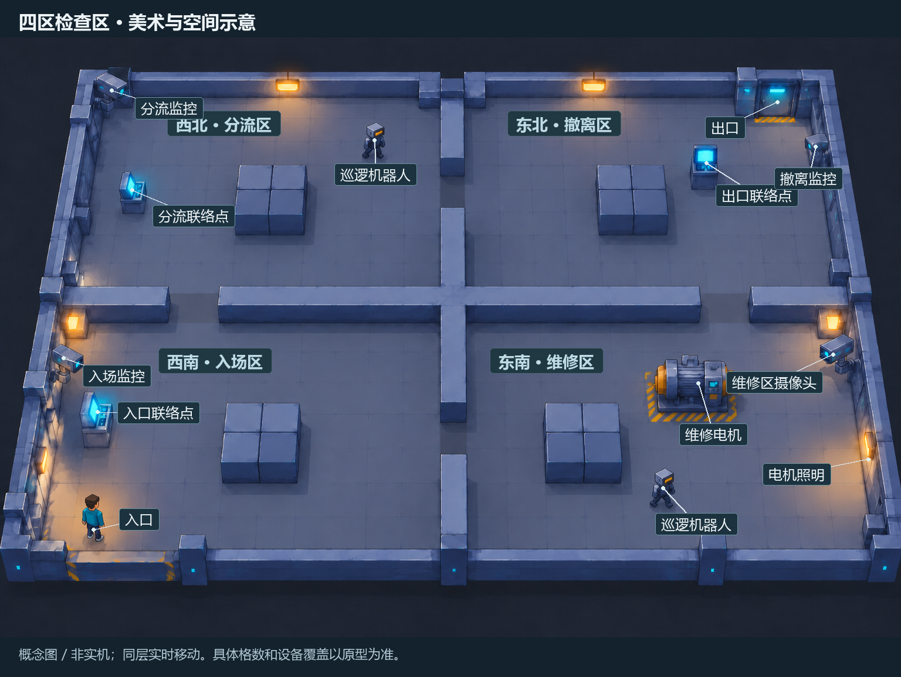

# 请本人到场

AI PLAY 72H 预赛方案 · nekoToken · 2026.11.16 · v0.7 图示修订版

> 你能重来，监控你的 AI 也记得上一轮。

2042 年，一位即将被 AI 代理永久接替的朋友发来请求：“这次，请你本人来。”你带着她的撤回申请，走向交接塔。途中，一处自动化检查区拦住了去路。

你要亲手修好电机、抵达出口。自己的 AI 助手可以调整监控设备，却看不见现场；管理城市的 AI 可以调度安防，却只能从设备报告判断你在哪里。你必须观察、描述、行动，并在重启后重新判断。

三方掌握不同信息、承担不同操作；现场动作与判定由游戏程序执行。

## 一、预赛信息卡

| 项目 | 内容 |
| --- | --- |
| 项目 / 队伍 | 《请本人到场》 / nekoToken |
| 赛道 / 命题 | AI 原生游戏 / 重启 RESET |
| 体验形式 | 实时潜入 + 个人 Agent 协作；整场目标约 10 分钟 |
| 核心摘要 | 玩家描述现场，助手改动设备，城市系统依据报告寻找玩家；四轮挑战中，各方保留自己的经历。 |
| 队长 / 队员 | 王嘉璐 / 董骏豪；各自邮箱、手机号待补 |
| 分工与能力 | 两人真实职责、相关经历及作品链接待补 |

## 二、赛题理解

我们希望重试仍有发现：同一张地图上，玩家保留经验，城市系统也会依据收到的线索调整监控。AI 通过设备配置改变潜入条件，RESET 让上一轮的交锋继续影响下一轮。

面向喜欢观察巡逻、寻找路线和时间循环，也愿意用简短对话讨论办法的玩家。我们想让“看清现场、说清情况、亲手执行”共同组成潜入的乐趣。

<!-- page-break -->

## 三、核心玩法与 AI 作用

### 设计点一：你看得见，助手改得动

玩家掌握现场，助手掌握设备接口。玩家先观察路线，再到联络点描述设备位置、扫描方向和自己的打算。助手据此追问、比较改法，提交玩家手操无法执行的设备调整。

助手没有地图或实时画面。描述里缺的现场信息，需要向玩家确认；改动落地后，仍由玩家亲自走位和维修。

**一次讨论的示例**

玩家：北侧通路会被维修区摄像头扫到。我想绕过去修电机。

助手：你到电机还要多久？机器人上次在哪里？

玩家：还有一段路。机器人刚才在南侧，过去时得再看。

助手：先把那台摄像头的扫描转离北侧，灯先不关。现在关，可能没走到就亮了；恢复行动后，再确认机器人的位置。

这次只改一项：选择持续的扫描调整，避开过早消耗关灯窗口。**讨论要落实为设备变化，变化还要由玩家亲自利用。**

每个联络点每轮可用一次，每次最多 1–2 个改动，各点独立。会话暂停全部游戏计时，结束后提交并恢复行动，离点后不能追加。助手首版拟只改灯和摄像头，不控制机器人、不篡改报告。

<!-- page-break -->

### 设计点二：被看见之后，争取在定位前离开

摄像头与机器人持续观察，按固定节奏批量上传“有人、无人、无法确定”，保留观察时间与区域。累计固定批次后，游戏暂停，城市系统提交固定形状、大小受限的定位范围；游戏程序检查是否命中。**目击留下线索，定位命中才触发回退或本轮失败。**

城市系统不能直接读取玩家坐标。玩家可以利用遮挡、路线分岔和设备改动，让较早的目击难以确定当前位置；维修也真实上报，因此完成任务时仍要考虑撤离窗口。

定位猜错后，城市系统可重调设备并新增一处设施，随后恢复行动；新增范围与数量由程序限制。拖得越久，监控可能越密。玩家要在观察、绕行与推进任务之间取舍。

灯只有亮暗，关灯受时长、冷却和同时数量约束；摄像头与机器人受照明、视野和遮挡限制。机器人按命令巡逻，不追人。双方对同一设备控制项按最后有效指令覆盖，设备本身不独立决策。

<!-- page-break -->

### 设计点三：现场回退了，交锋的记忆还在

玩家可以撤回一次失误，城市系统也能在整轮结束后重新安排挑战。**重启恢复现场，各方仍记得自己经历过的事。** 上一轮有效的走法，下一轮需要重新观察。

**一次跨轮变化的演示设想**

上一轮，城市系统在南侧通路多次收到目击报告。重启后，它把一台摄像头的扫描区间转向那里。玩家观察到变化，在联络点告诉助手，结合之前的尝试讨论另一条路。摄像头的改动来自已收到的线索，不需要城市系统偷看玩家完整路径。

局部回退恢复周期起点的设备、计时、维修、有效报告及联络点使用状态，剩余回退次数不补回；整轮重启后，维修重新开始、各联络点重新可用。旧命令不会自动重交。

玩家记得亲历的现场；助手记得描述、对话与操作回执；城市系统记得报告和自己的判断。被撤销的记录标为历史，不能冒充当前目击，也不会让任何一方获得额外地图权限。

### 一轮怎样结束

修好电机并抵达出口，本轮成功。定位命中后，玩家可选择回退；放弃或用尽机会，本轮失败。失败后仍进入后续轮次，四轮结束后按成功情况、用时与消耗综合评价。

### 为什么还需要玩家本人

助手能移开一个观察来源，不能保证整段路线安全。灯会恢复，机器人会继续巡逻，城市系统之后也可能重新调度。玩家离开联络点后，必须自己观察变化、判断何时移动。

我们希望取舍来自有限干预与变化中的现场。求助次数本身不判负；把旧建议当成永久安全保证，才可能让一次本可调整的潜入失败。

<!-- page-break -->

### 场景示意：四区互通的检查区

图示沿用原概念图，放大展示中文名称。全图同层、实时移动；概念图未表示最终照明和视野覆盖，设备数量与地图尺寸仍是布局候选。

| 分区 | 任务与选择 |
| --- | --- |
| 西南入场区 | 入口与入口联络点；先观察，再决定走法 |
| 西北分流区 | 分流联络点与另一条通路；提供绕行选择 |
| 东南维修区 | 电机、摄像头和遮挡；接近、停留维修后还要离开 |
| 东北撤离区 | 出口联络点与出口；维修完成后抵达这里 |

旧目击只说明当时所在区域。玩家之后可能沿不同路线移动，城市系统需要结合时间和后续报告判断；不能把较早目击当作玩家现在的位置。

<!-- page-break -->

## 四、方案价值与预期效果

我们希望玩家经历三种紧张：**描述是否足够准确、留下目击后能否及时离开、重启后还能否使用旧办法。** 对话、设备变化和实时走位相互影响，让每次求助都对应一段具体风险。

在制作上，四轮复用一张地图和相同设备，由 AI 在允许范围内改变配置。预期用较少的手工关卡变体呈现不同监控安排，把开发重点放在变化是否可读、任务是否有进退窗口。

### 72 小时内拟交付的原型

**Godot；两人；一张四区互通地图；修电机后撤离；初始轮与三次整轮重启；整场目标约 10 分钟。** 高俯角 2.5D，以模块化地板、隔墙、遮挡和设备搭建。

| 阶段 | 工作与可演示结果 |
| --- | --- |
| 0–30h | 地图灰盒、移动维修、设备观察与报告、周期定位；尽早试通两个 Agent 的调用 |
| 30–58h | 联络与设备改动、指令覆盖、局部回退、整轮重启与各自记忆 |
| 58–72h | 跑通四轮，调整维修及撤离窗口、模型等待和总时长，整理美术并打包 |

### AI 怎样接入，规则怎样执行

| 参与方 | 输入与输出 |
| --- | --- |
| 个人助手 | 通过随游戏提供的 skill 了解操作与权限；依据玩家描述，调用设备接口提交改动 |
| 城市系统 | 游戏在定位节点提供地图、配置和报告；模型返回定位范围，猜错后再提交调度 |
| 游戏程序 | Godot负责移动、观察、计时、权限与参数校验、状态恢复和命中判定；模型通过受限接口改设备 |

模型在联络与定位节点参与，推理期间暂停现场。优先验证描述能否转为有效改动、报告能否支持定位，再调整节奏。十分钟包括四轮行动、会话、模型等待和回退；当前为设计目标，尚无试玩数据。

## 五、方案优势与创新点

- **描述能改变现场。** 玩家把观察交给自己的 Agent，助手把讨论转成设备改动，玩家亲手完成潜入。
- **对手依据线索调度。** 城市系统从带时间差的报告推断位置，失误后重新安排监控；行动会影响之后的挑战。
- **双方带着经历重来。** 玩家回退与城市重启作用不同，记忆持续保留，让同一张地图承载连续试探和调整。

方案基于团队既定玩法；图示为概念材料。难度与时长待原型验证；信息卡中的联系方式、真实分工和能力资料待补。赛事栏目沿用2026年11月15日留存复核。
