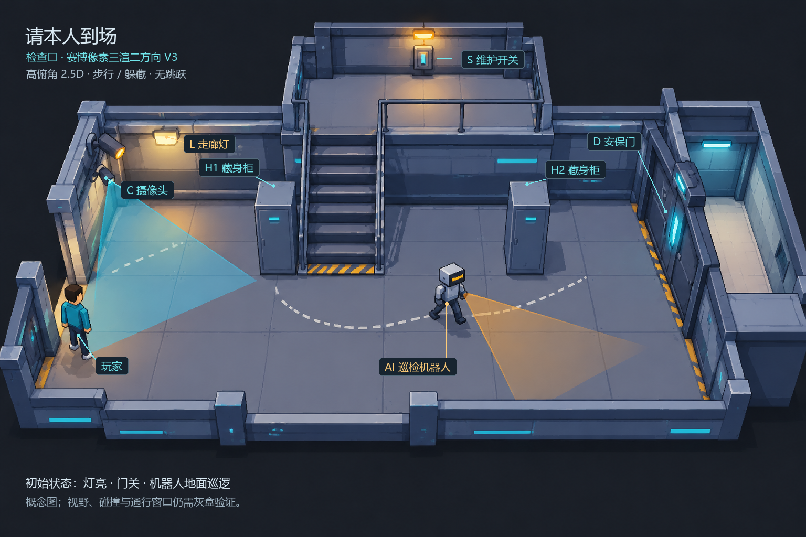

# 《请本人到场》V3：赛博像素三渲二与 AI 敌人

日期：2026-11-14。状态：按用户意见生成的美术方向候选；没有开始实现，不代表最终美术资产或已验证关卡。

> **机制后续更新**：当前以[侦测定位机制基准](../../../../侦测定位_机制草案.md)为准。用户最新确定同层方格、无楼梯与高差，系统在周期边界决定巡逻和摄像头调度，个人 Agent 仅在联络点接入。V3只保留美术风格参考；下方楼梯、高台、维修开门、追捕与抓获均为历史提案，不进入当前制作清单。尚未生成新方格布局图。

## 当前画面

[无标注原图](请本人到场_检查口_赛博像素三渲二_v3_raw.png) · [实际编辑提示词](请本人到场_检查口_赛博像素三渲二_v3_prompt.txt) · [生成记录](请本人到场_检查口_赛博像素三渲二_v3_生成记录.json)

## 美术方向

- 维持高位2.5D俯视；保留现场地面深度、后侧高台与普通楼梯，不跳跃。
- 科幻来自模块化设施、传感器、电子门与少量信号灯带。配色暂用蓝灰底色、青色设备、琥珀色危险提示；不依赖复杂纹理和霓虹招牌堆叠。
- 玩家采用简单块面和少量服装色块；机器人采用方头、单条目镜、躯干与简化双足。不要求脸部、手指、衣褶或复杂机械关节。
- 视觉目标是简单3D块面、少量明暗色阶、清楚的像素边缘。当前生成图仅用于讨论这种效果；精确像素尺寸、描边方式和 Godot 实现路线未锁定。

## 敌方 AI 与我方 Agent

| 主体 | 在本关中的作用 | 72小时范围提案 |
| --- | --- | --- |
| 世界 Agent | 管理安防系统，抓获后读取事件并选择下一轮合法配置 | 受限选择、程序验证；不临场任意修改地形 |
| AI 巡检机器人 | 世界 AI 的现场执行端，巡逻、检测、抓获、处理照明故障 | 日常行为用可观察状态机，保留走楼梯和按 S |
| 个人 Agent | 玩家助手，读取线路与维护规则，结合玩家观察提出改线 | 经玩家批准调用同一组受控接口；没有额外跟随角色 |

既有解法保持：C→L、S→D；玩家进入摄像头范围使灯熄灭，机器人依维护流程上楼按 S，改接后的信号打开 D，玩家等待通道空出后亲自通过。利用维护流程成立的前提是机器人不能在远端直接恢复照明，也不能偷偷绕过接线打开设备；这些应写进关卡维护规则，灰盒中真实执行。

“敌人是 AI”不等于所有敌方动作都应调用大模型。确定性巡逻能让玩家观察和规划，世界 Agent 的受限重建承担另一层变化。此分层仍未解决对话助手相对菜单的额外价值，也未解决过度依赖助手的自然代价。

## 建议控制的制作量

- 场景只做一个房间；墙、地板、栏杆和楼梯使用重复模块。
- 角色仅玩家和巡检机器人两种；两处藏身柜复用同一造型。
- 摄像头、灯、开关、门各一种；状态优先通过灯光、色块和简单位移表达。
- 动画先考虑行走、停留、按开关、抓获反馈；不增加战斗、布料和面部系统。
- 概念图里的面板线、磨损和小灯均不自动进入制作清单；可继续删减。

## 验证与交付边界

本轮使用已获授权的 imagegen CLI/API 后备方式，以 V2 无标注图为布局编辑输入；未重新索取密钥或更改永久配置。保留原图并另存 V3。

已检查高俯角、简化角色、单个人类玩家、单台双足机器人、两个柜子、完整楼梯、门关灯亮。生成画面仍可能包含装饰性灯具或传感器，不应自动解释为新增机关。视野覆盖、是否可以贴边绕行、碰撞与通行时间仍需真实灰盒验证。

现有 V0.1 PDF 尚未同步本轮风格、敌人身份及此前2.5D操作修改。
