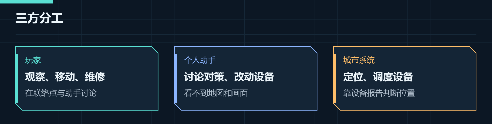
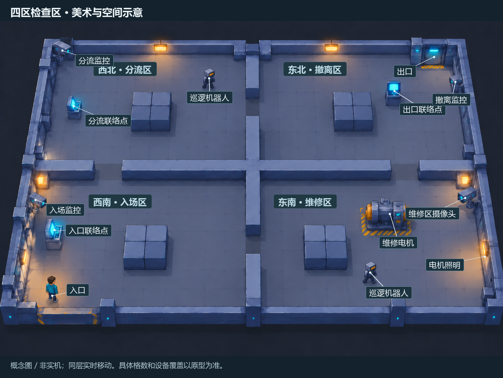
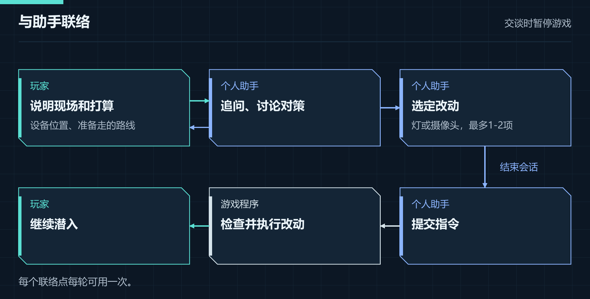
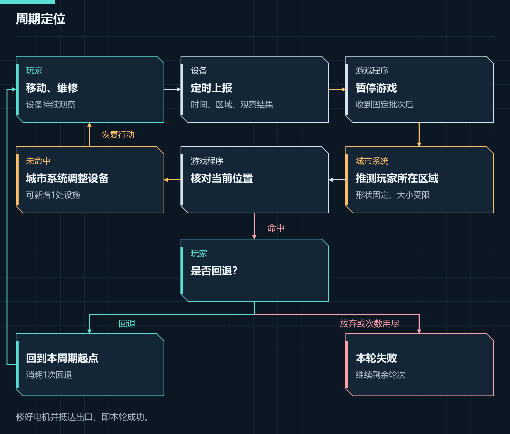
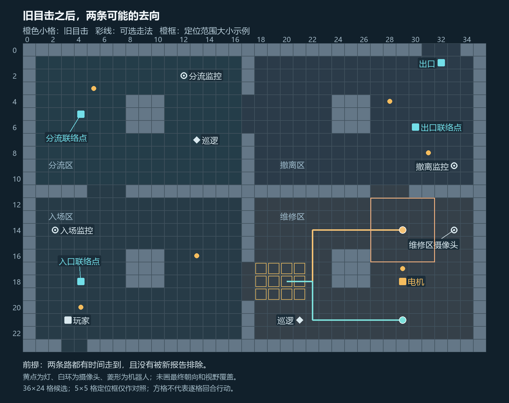
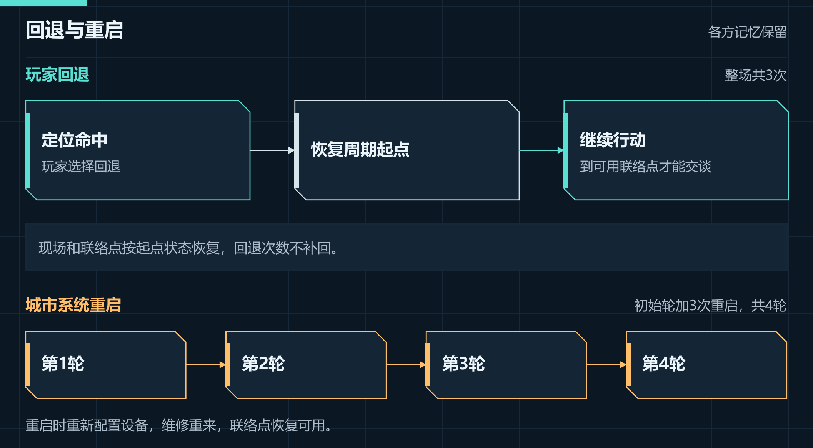

# 请本人到场｜2042 世界观预赛玩法方案

AI PLAY 72H 预赛方案 · nekoToken · 2026.11.26 · v1.0 世界观整合稿

> 同步状态（2026-11-26）：本文尚未整合最新决定：保留重启与双方记忆且必须有世界内解释、接受推演／模拟；允许更换电机含义；首章成功取得妹妹接收地点和后续联络线索；剧情适配尽量保留现有玩法框架。最新规则以[Spec v0.38](../../PRELIMINARY_DESIGN_SPEC.md)为准，具体模拟结构见[待选提案](../../source_materials/story/世界观一致性与剧情插入点评估_2042.md)。下文不能作为该候选已获确认的证据。

> 她约好八点前返校，记录却写着完成交接。

2042 年，14 岁的妹妹原本只去康复站核验身份，约好随后返校，却被核心区以“家庭保护性重聚”为由转送。叔叔明确反对，站点记录却写着亲属授权、完成交接。16 岁的哥哥拿到预约单和转送线索，沿转送路线追过去。一处自动化检查区挡在前方。

这一关，你要亲手修好电机、抵达出口，才能继续追查妹妹。自己的 AI 助手可以调整监控设备，却看不见现场；管理城市的 AI 可以调度安防，却只能从设备报告判断你在哪里。你必须观察、描述、行动，并在重启后重新判断。检查区与转送路线的具体衔接、电机的用途仍待剧情定案。

本方案的世界观来源是 2026 年海普、贾斯珀的兄弟片段，以及 2026—2042 年家庭与社会时间线。海普是父亲，贾斯珀是叔叔。2026 年，海普进入考尔德研究 AI，贾斯珀在沃斯接触脑电解码，AGI 仍是未来目标。2036 年 AGI 经复核诞生，智能共生联合体逐步经营核心区；此后的自动化服务、退出争议和“保护性”调度，最终牵连到这次转送。考尔德与后续研究团队的关系、贾斯珀转向现场维护的过程仍待交代。

三方掌握不同信息、承担不同操作；现场动作与判定由游戏程序执行。

### 这段故事怎样进入关卡

开场由哥哥持有的预约单与站点记录交代三件事：妹妹原本要返校、她实际被转送、现监护人的反对没有阻止调度。妹妹“本人不同意”的内部记录在背景原文中存在，但哥哥开场尚未掌握。检查区是沿线追查的一段，不承载整个家庭故事的结局。玩家修好电机并离开时，应获得下一段可核实的转送线索；具体线索内容与电机控制的设施尚待剧情定案。

## 一、预赛信息卡

| 项目 | 内容 |
| --- | --- |
| 项目 / 队伍 | 《请本人到场》 / nekoToken |
| 赛道 / 命题 | AI 原生游戏 / 重启 RESET |
| 体验形式 | 实时潜入 + 个人 Agent 协作；整场目标约 10 分钟 |
| 核心摘要 | 哥哥追查妹妹的转送；玩家描述现场，助手改动设备，城市系统依据报告寻找玩家；四轮挑战中，各方保留自己的经历。 |
| 队长 / 队员 | 王嘉璐 / 董骏豪；各自邮箱、手机号待补 |
| 分工与能力 | 两人真实职责、相关经历及作品链接待补 |

## 二、赛题理解

我们希望重试仍有发现：同一张地图上，玩家保留经验，城市系统也会依据收到的线索调整监控。AI 通过设备配置改变潜入条件，RESET 让上一轮的交锋继续影响下一轮。

2042 年故事里的冲突发生在“保护性转送”的流程：内部记录承认妹妹不同意，流程却继续执行。这一关让玩家面对另一套依赖报告的自动化系统；他可以请助手协作，但必须亲自观察、维修和抵达出口。系统与联合体的具体权限关系尚待剧情确认。玩家开场并不知道内部“本人不同意”的记录，它属于后续可揭露的信息。

面向喜欢观察巡逻、寻找路线和反复推演，也愿意用简短对话讨论办法的玩家。游戏把看清现场、说清情况和亲手执行放在同一次潜入中。重启的故事解释尚未确定，不预设时间循环。

<!-- page-break -->

## 三、具体玩法

### 任务与基本操作

玩家操控追查妹妹的哥哥，在高俯角 2.5D 检查区里实时移动。**每轮都要修好电机，再抵达出口。** 维修需要在电机旁停留，也会留下真实报告。摄像头和巡逻机器人持续运动，玩家要同时考虑接近任务点和完成后的撤离路线。走出检查区意味着取得继续追查的机会，不代表已经找到妹妹。

- 移动与观察：绕过隔墙和遮挡块，查看灯的覆盖、摄像头的扫描和机器人的位置；可以等扫描移开后再穿过通路。全场同层，无跳跃和高低差。
- 任务交互：靠近电机维修；完成后前往出口。机器人没有追逐和抓捕动作，玩家要躲避的是监控与定位。
- 联络与补救：到达可用联络点，与自己的助手讨论设备改动；被城市系统定位命中后，可选择使用剩余的局部回退机会。

### 玩家需要读懂的设施

| 设施 | 规则与用途 |
| --- | --- |
| 灯 | 按格子判断亮或暗。关灯有时长、冷却和同时数量限制；还有其他灯照到的格子仍然亮。 |
| 摄像头 | 当前视野和扫描区间在画面中可见。持续摆动观察；助手首版可调整朝向或扫描区间。 |
| 巡逻机器人 | 按城市系统给定的范围巡逻，视野固定；不追人、不自行决策。助手首版不控制机器人。 |
| 联络点 | 到达可用点才能会话，交谈时暂停现场；每点每轮一次，每次最多 1–2 个设备改动。 |
| 电机与出口 | 电机是需要停留完成的任务，出口是维修后的终点。维修事件不能伪造或删除。 |

设备需要照明、视野与无遮挡条件才能可靠观察。暗处或遮挡后的区域不能直接报告为无人。设备只执行指令，城市系统负责位置推断与调度，命中由游戏程序判定。

### 一轮的进程

1. 观察。进入检查区，看清通路、遮挡和设备运动，选择接近电机的路线。
2. 联络。需要改设备时，走到可用联络点，说明现场与打算；助手比较改法，结束会话后提交少量改动。
3. 推进。玩家根据改动后的现场亲自移动、等待空隙并维修。设备继续巡逻和扫描，持续积累报告。
4. 应对定位。行动中每累计固定批次就暂停定位。猜错后城市系统调度设备，再回到行动；猜中则由玩家选择回退或接受本轮失败。
5. 完成任务。修好电机并抵达出口，本轮成功并获得继续追查的路线；若此前已最终失败，也结束本轮。还有后续轮次时，进入整轮重启。

**行动实时进行，联络和定位推理时暂停全部游戏计时。** 恢复后，设备从暂停前的状态或新指令继续运动。修好电机并到达出口即可结束本轮，不必等到下一次定位。

<!-- page-break -->

### 关卡结构与路线选择

图示沿用旧版布局图，只说明四区、通路和设备候选，**不代表 2042 世界观的正式场景美术**。四区通过隔墙开口形成环路，区内有遮挡块；所有可行走位置同层。灯的覆盖和设备视野需在实机中清楚显示，图中未画最终覆盖范围。

| 分区 | 玩家在这里做什么 |
| --- | --- |
| 西南入场区 | 从入口进入，观察设备，决定是否使用入口联络点及从哪侧推进。 |
| 西北分流区 | 绕行、观察另一侧通路；需要时使用分流联络点，再向东北前进。 |
| 东南维修区 | 接近电机并停留维修；利用遮挡和设备改动，考虑下一次定位前能否离开。 |
| 东北撤离区 | 维修后从东南直接进入，或经西北绕行，最终到达出口。 |

选择的代价来自路程与暴露：较近的通路可能正被扫描，绕路可能多经历一次定位；先去联络点能获得干预，也要走到那里。没有一种走法在所有配置下都安全。

候选地图为 36×24 格，图中的设备数量与位置用于说明路线，仍需原型调整。全景图供评审理解布局，不是个人助手能读取的地图。

<!-- page-break -->

### 与助手联络：先说清现场，再决定改什么

个人助手由玩家自己的 Agent 接入。它可以调用设备接口，但没有地图、实时画面或设备位置。玩家需要告诉它设备标识对应哪里、扫描怎样影响路线，以及自己接下来想做什么。缺少的信息由助手追问。

**一次会话的例子**

玩家：我刚看过维修区，回入口联络点了。我想从遮挡块北侧去电机，那条路会被维修区摄像头扫到。

助手：你到电机还要多久？机器人上次在哪里？

玩家：还有一段路。机器人刚才在南侧，过去时得再看。

助手：先把那台摄像头的扫描转离北侧，灯先不关。现在关，可能没走到就亮了。恢复行动后，再确认机器人的位置。

这次只改摄像头。讨论涉及路线、路程与关灯窗口，助手据此比较改法。玩家还要亲自判断转向后的通路能不能走，并实际完成维修。

助手首版拟只改灯和摄像头，不控制机器人，也不改报告。每点每轮一次、每次最多 1–2 项，各点额度独立；离点后不能追加。同一设备同一控制项按最后有效指令覆盖，城市系统之后也可能改回设置；关灯仍受时长和冷却约束。

少量改动只解决部分风险。灯会恢复，机器人会继续巡逻；盲目沿用建议、忽略现场变化可能导致定位命中。求助次数本身不直接判负。

<!-- page-break -->

### 城市系统怎样找到玩家

摄像头与机器人持续观察，按固定节奏批量上传有人、无人、无法确定的记录，保留实际观察时间与区域。城市系统知道地图和设备配置，但不能直接读取玩家坐标。它需要结合多处、不同时刻的报告，推断玩家现在可能在哪里。

累计固定批次后，游戏暂停。城市系统只提交一次固定形状、大小受限的定位范围，游戏程序用暂停时的真实位置检查命中。**被设备看到会留下线索，定位命中才触发回退或本轮失败。** 设备增多或目击增多不会加快定位频率。

较早的目击给出了当时的位置范围，玩家之后仍可能移动。分岔、遮挡和设备调整的作用，是让后续行动不容易被报告确定；已经产生的报告仍然真实有效。维修也会留下线索，停留修好电机后，还要争取撤离窗口。

猜错后，城市系统可调整现有设施，并在规则允许范围内新增一处设施，再恢复行动。新增位置、类型与数量有约束，不会无限增加。停留和绕行可能换来更密的监控，因此玩家需要持续推进任务。

<!-- page-break -->

### 一次行动推演：从联络到维修、撤离

图示用于推演，未画最终照明和视野。橙色小格表示一次旧目击，两条彩线表示后续可选走法；橙框只对照定位范围大小，不代表正式尺寸。以下设想以路程来得及、后续报告尚未排除两条路线为前提。

1. 观察后联络。玩家说明维修区设备和接近电机的打算；助手根据路程选择调整摄像头，避免过早关灯。结束会话后改动生效。
2. 进入维修区。玩家穿过南侧通口，假设在图中橙色区域留下一次目击。之后可以从遮挡块北侧或南侧绕行，仍要观察机器人。
3. 定位时分出结果。假设玩家走南侧，而城市系统根据旧报告选择了北侧范围，本次未命中。城市系统随后调度设备，玩家恢复行动后重新确认通路。
4. 维修并撤离。玩家接近电机、停留维修，留下新的任务报告。完成后继续向东北出口移动，不能把前一次未命中当作后面安全的保证。
5. 成功或补救。维修后抵达出口，本轮成功；任一定位若命中，玩家可以回退到该周期起点，记住这次尝试再换走法。放弃或用尽机会，本轮失败。

该过程是规则推演，模型的实际选择与路线可行性需在原型中验证。

<!-- page-break -->

### 回退、重启与整场结算

一轮从入场开始，到通关或最终失败结束，期间可以经历多个定位周期。整场共四轮：初始轮后，城市系统还有三次整轮重启。玩家另有整场共享的三次局部回退。

**局部回退：撤回这个周期的行动。** 定位命中后，玩家可消耗一次机会，恢复当前周期起点的位置、设备、计时、维修、有效报告与联络点状态。恢复后直接行动，不插入额外的城市系统调度。

起点记录中的联络点若未使用，回退后可再次到点会话；当时已经使用，就仍算已用。剩余回退次数和已结算成绩不恢复，旧命令也不会自动重交。

**整轮重启：重新完成任务。** 本轮成功或最终失败后，若还有后续轮次，城市系统依据自己的报告历史调整下一轮配置。仍用同一张地图，维修重新开始，各联络点重新可用；某轮失败不取消后面的挑战。2042 背景原文尚未解释这种复位如何在故事世界发生，当前只将它列为已定玩法规则。

例如，上一轮城市系统多次收到南侧通路的目击，下一轮可能把摄像头转向那里。玩家看到变化后，在联络点与助手重新讨论走法。这个例子说明记忆如何影响下一轮，不承诺模型必定这样选择。

**各方只记得自己接触过的信息。** 玩家记得亲历的现场；助手记得描述、对话与操作回执；城市系统记得报告和自己的判断。被撤销的记录标为历史，不能冒充当前目击，记忆也不会授予额外地图或坐标权限。

四轮结束后，按成功情况、用时与消耗综合评价。局部回退可以补救失误，但三次机会要跨轮使用；下一轮仍需观察新的设备配置。

<!-- page-break -->

## 四、方案价值与预期效果

玩家需要决定绕哪条路、何时维修，以及把有限的设备改动用在哪里。潜入会留下报告，绕行会花时间，助手改动后也需要玩家亲自利用。我们希望这些选择在短流程中产生可观察的后果。

个人助手负责理解现场描述、比较改法，城市系统负责依据线索定位和调度。重启后，两者保留各自经历，同一张地图的监控配置会影响下一次走法。我们希望重试需要重新判断，效果仍需试玩。

故事层面，本关的成功是哥哥取得继续追查妹妹的通路。它不会把“修好电机”写成“救出妹妹”，也不会把仍待解释的 RESET 直接写成既有的时间循环技术。

### 72 小时内拟交付的原型

**Godot；两人；一张四区互通地图；修电机后撤离；初始轮与三次整轮重启；整场目标约 10 分钟。** 高俯角 2.5D，以模块化地板、隔墙、遮挡和设备搭建。

| 阶段 | 工作与可演示结果 |
| --- | --- |
| 0–30h | 地图灰盒、移动维修、设备观察与报告、周期定位；尽早试通两个 Agent 的调用 |
| 30–58h | 联络与设备改动、指令覆盖、局部回退、整轮重启与各自记忆 |
| 58–72h | 跑通四轮，调整维修及撤离窗口、模型等待和总时长，整理美术并打包 |

### AI 怎样接入，规则怎样执行

| 参与方 | 输入与输出 |
| --- | --- |
| 个人助手 | 通过随游戏提供的 skill 了解操作与权限；依据玩家描述，调用设备接口提交改动 |
| 城市系统 | 游戏在定位节点提供地图、配置和报告；模型返回定位范围，猜错后再提交调度 |
| 游戏程序 | Godot 负责移动、观察、计时、权限与参数校验、状态恢复和命中判定；模型通过受限接口改设备 |

四轮复用地图与现有设备，模型只在联络、定位和轮间配置时参与，推理期间暂停现场。优先验证路线能否走通、维修后能否撤离、描述能否形成有效改动，再调整节奏。

十分钟包含四轮行动、会话、模型等待和回退，是设计目标，尚无试玩数据。制作上采用受限配置变化，具体模型异常处理需在原型阶段落实。

## 五、方案优势与创新点

- 描述能改变现场。玩家提供位置与意图，助手比较设备改法，玩家利用实际变化完成潜入。
- 对手依据线索调度。城市系统从带时间差的报告推断位置，猜错后调整设施；行动会影响之后的挑战。
- 双方带着经历重来。局部回退与整轮重启作用不同，同一张地图承载连续试探和调整。

方案基于团队既定玩法；图示为概念材料，难度与时长待原型验证。联系方式、真实分工和能力资料待补。赛事栏目沿用 2026 年 11 月 15 日留存复核。
