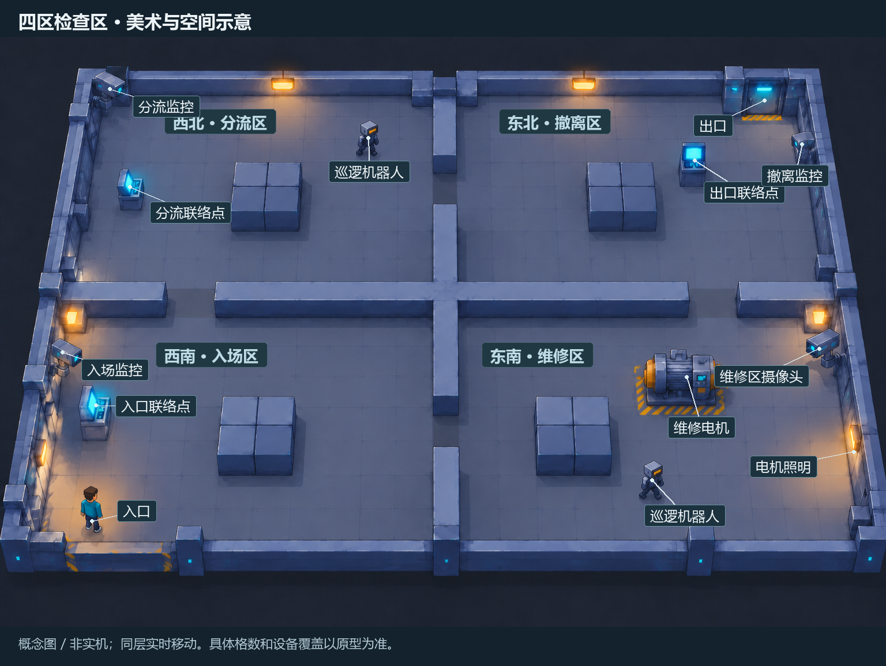
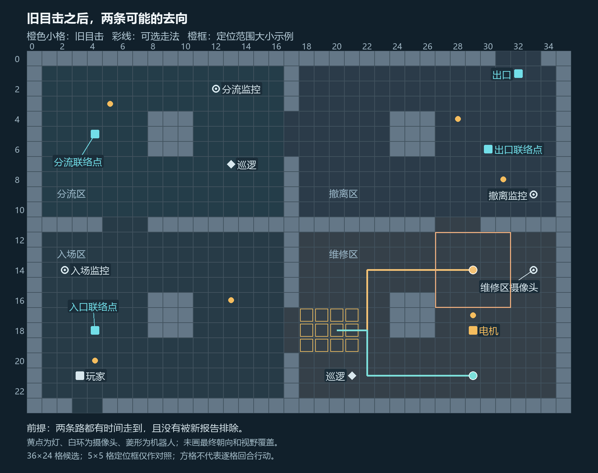
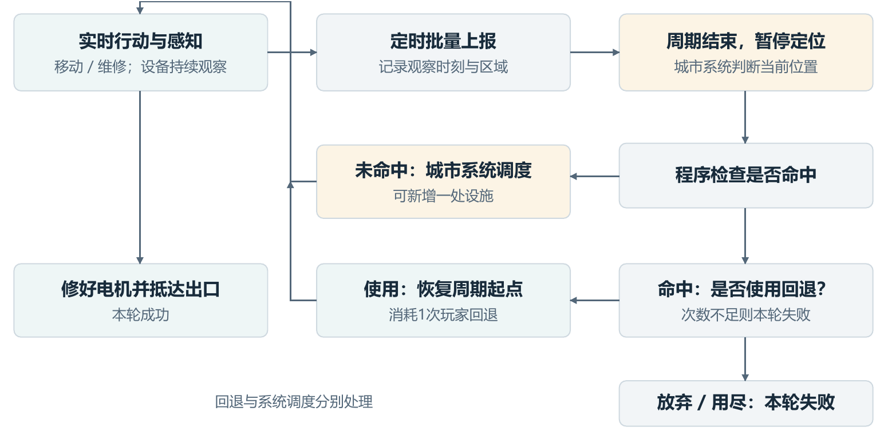
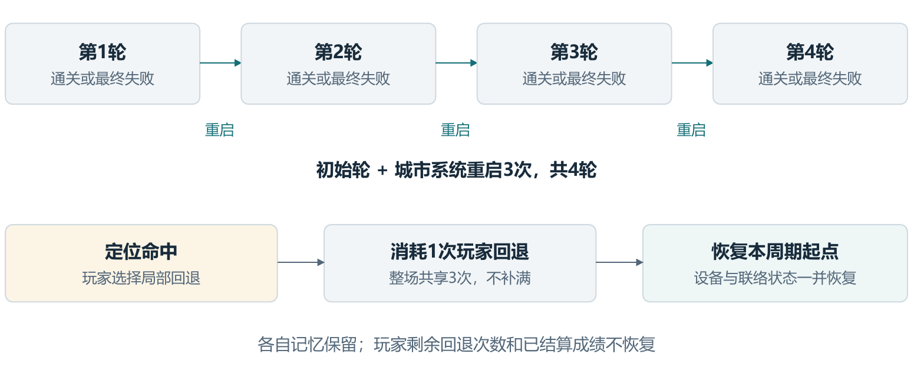

# 《请本人到场》2042 世界观 · 预赛玩法框架 v0.4

当前方案：[可编辑稿 v1.0](pdf/AI_PLAY_72H_预赛方案_2042世界观整合_v1.0.md)。本页只讲玩法，未概括剧情；具体规则以当前设计 Spec 和机制基准为准。旧世界观版本见[产物索引](README.md)。

## 玩家的任务

走进检查区，亲手修好电机，再抵达出口。设备被动观察，不追人；城市系统定期从报告判断你在哪里。看见不直接判负，定位命中时仍可用局部回退。

## 怎么和个人助手合作

个人助手是玩家自己的Agent，没有地图或实时画面。玩家先观察，在联络点把路线、设备标识和现场描述给它；助手追问、比较改法，通过专属接口改灯或摄像头，玩家再执行路线。

每个点每轮一次会话，每次最多1–2个改动。联络期间暂停全部游戏计时，离点后不能追加。各点机会独立，不是一个整场共享干预池。助手改完以后，灯仍会恢复、机器人仍会运动，城市系统还可能重新调度；玩家需要继续观察。

## 场景给了哪些选择

先按36×24格候选安排四个相通分区。入口在西南、维修在东南、出口在东北，西北提供另一条通路；遮挡块让局部路线也能绕行。全图同层、实时移动，不跳跃。图示3个联络点、1台电机、4台摄像头、6盏灯和2台机器人，数量与位置待原型验证。

旧目击只说明当时的区域。若剩余行动时间够、两条路也未被新报告排除，定位时就可能留下两个去向。图中5×5格只是定位大小对照。维修事件依然真实上报，单电机也暴露当时位置；不能只靠扩地图或关灯保证安全。

## 城市系统怎么反制

设备持续观察，按节奏成批上报，保留实际时间。累计固定批次后暂停，城市系统猜一次范围，游戏程序判断命中；猜错后可以改设备并新增一处设施。未知不是无人。范围大小受程序限制，具体参数待定。

## 重启留下什么

整场四轮：初始轮加城市系统3次整轮重启。玩家另有整场共享3次局部回退，回到当前行动周期起点。设备、计时、任务和联络状态随记录恢复，剩余回退次数不补回。起点中未用的联络点可再会话，已用则仍已用；旧指令不会自动重交。

各自保留接触过的经历，旧分支注明属于过去。助手不会因此获得地图，城市系统不会因此获得真实玩家坐标。

## 原型优先回答的问题

维修能否有进退窗口，旧报告后是否真有多种走法，少量改动是否值得讨论，以及四轮加上对话和推理能否控制在约10分钟。求助越多必败、AI一定能有效反制、当前地图已平衡，都不是现有结论。
